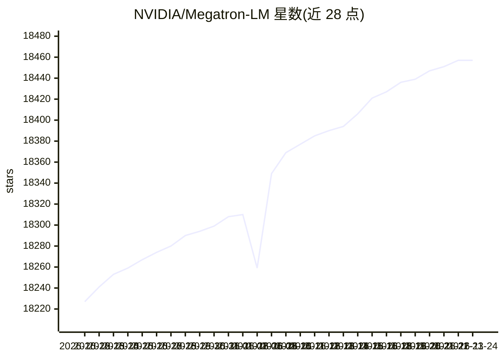

# NVIDIA/Megatron-LM

⭐ 18,457 · Python · NOASSERTION · 推送 2026-11-22 · [GitHub](https://github.com/NVIDIA/Megatron-LM) · [官网](https://docs.nvidia.com/megatron-core/developer-guide/latest/get-started/quickstart.html) · 组织维护

**NVIDIA 的大规模 transformer 训练 GPU 优化库**

NVIDIA 维护的大规模训练库，含两个组件：Megatron-LM 提供带预配置训练脚本的参考示例，面向研究团队、分布式训练学习与快速实验；Megatron Core 提供可组合的 GPU 优化构建块，含 TP/PP/DP/EP/CP 并行策略、FP16/BF16/FP8/FP4 混合精度与多种模型架构，面向构建自定义训练流程的框架开发者。另含 Megatron Bridge 提供 Hugging Face 与 Megatron 双向 checkpoint 转换。安装支持 PyPI 与源码编译，推荐 Python 3.12+ 与 PyTorch 2.6.0+。

## 筛选速览

| 维度 | 判定 | 备注 |
|---|---|---|
| AI 角色 | `ai-ecosystem` | LLM/agent 周边工具 |
| 许可风险 | `none` | NOASSERTION |
| 部署形态 | `library` | 以包/库形式分发 |
| 模型依赖 | — | README 未给出锁定关系 |
| 硬件要求 | — | 无带数字的原话,不猜 |
| 安装摩擦 | `medium` | 含编译或系统依赖之一 |
| 成熟度 | — | 结构信号不足 |

## 动量与使用信号

- 维护:`active` — 距上次 push 0.6 天,年发版 19,343 位贡献者
- 涨星:近 1 天 **+11**(自 20261016 起算)
- 安装:pypi 包 `megatron-core` 月下载 357,313

## 能力要点

- TP/PP/DP/EP/CP 五种并行策略与 FP16/BF16/FP8/FP4 混合精度支持
- Megatron Bridge 提供 Hugging Face ↔ Megatron 双向 checkpoint 转换
- 提供性能基准数据与复现说明（DGX-GB200/GB300 平台结果）
- 支持从 PyPI 或源码安装

## 适用场景

- 研究团队运行大规模分布式预训练实验
- 学习分布式训练与并行策略
- 框架开发者基于构建块搭建自定义训练流程
- 将 Hugging Face 模型 checkpoint 转换为 Megatron 格式训练

## 场景标签

`模型训练` · 领域:训练与推理

## 证据(README 行号)

> L3:  GPU-optimized library for training transformer models at scale
> L15: **Megatron Core** is a composable library with GPU-optimized building blocks for custom training frameworks. It pro

## 星数曲线

2026-10-22 18,227 → 2026-11-24 18,457（+230）

---
*卡片 v1 · prompt 1.4 · 生成 2026-11-22 · 置信度 high · 依据 README sha `2e28958ad948` · [字段定义](../../DATASET.md)*
