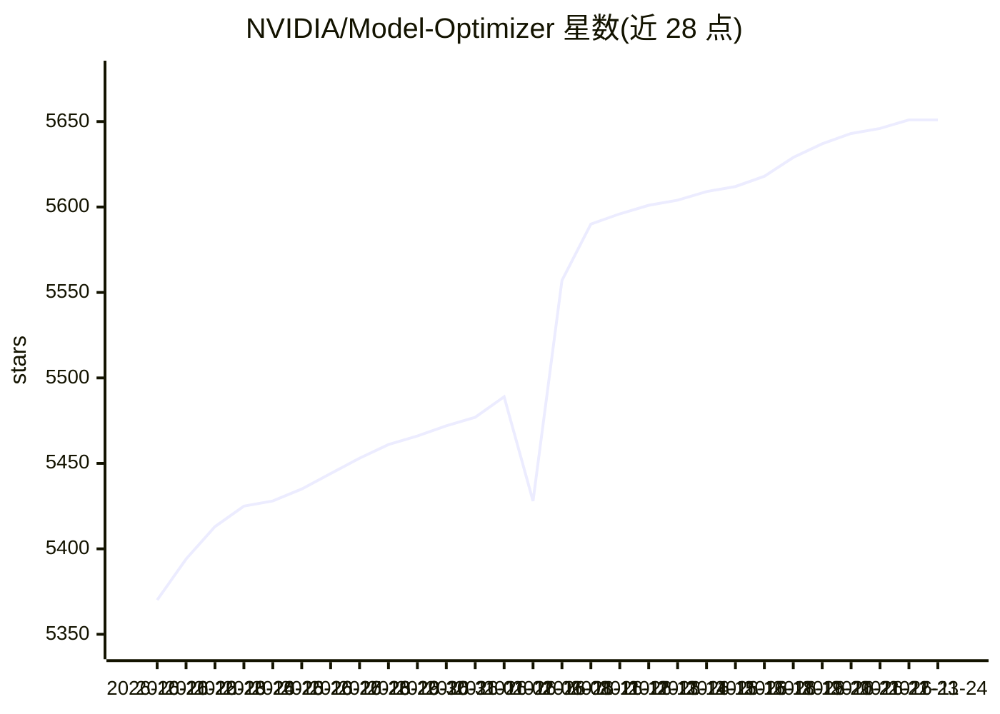

# NVIDIA/Model-Optimizer

⭐ 5,655 · Python · Apache-2.0 · 推送 2026-11-24 · [GitHub](https://github.com/NVIDIA/Model-Optimizer) · [官网](https://nvidia.github.io/Model-Optimizer/) · 组织维护

**模型压缩优化库：量化/剪枝/蒸馏后导出部署**

NVIDIA 提供的 Python 库，输入支持 Hugging Face、PyTorch 或 ONNX 模型，通过 Python API 组合量化、剪枝、蒸馏、NAS、投机解码、稀疏化等技术，生成优化后的量化检查点，并可导出至 TensorRT-LLM、TensorRT、vLLM、SGLang 等推理框架部署。同时提供预量化检查点下载、各技术支持矩阵与 deprecation 政策，并附带 Claude Code/Codex 可安装的 agent 技能。

## 筛选速览

| 维度 | 判定 | 备注 |
|---|---|---|
| AI 角色 | `ai-ecosystem` | LLM/agent 周边工具 |
| 许可风险 | `permissive` | Apache-2.0 |
| 部署形态 | `library` | 以包/库形式分发 |
| 模型依赖 | local-ok | 支持本地模型 |
| 硬件要求 | — | 无带数字的原话,不猜 |
| 安装摩擦 | `low` | 无编译、无系统依赖或容器化 |
| 成熟度 | `idea` | |

## 能力要点

- 支持 PTQ、QAT/蒸馏、剪枝、NAS、投机解码、稀疏化六类优化技术
- 输入支持 Hugging Face、PyTorch、ONNX 模型，统一 HF 导出 API 覆盖 transformers 与 diffusers
- 量化检查点可导出至 TensorRT-LLM、TensorRT、vLLM、SGLang 部署
- 提供预量化检查点合集与各技术支持矩阵

## 适用场景

- 部署前将大模型量化压缩以减小体积并提升推理速度
- 通过剪枝与蒸馏训练更小的部署模型
- 生成 FP8/NVFP4 检查点供 vLLM 或 TensorRT-LLM 加载

## 场景标签

`模型量化` · 领域:训练与推理

## 证据(README 行号)

> L13: **NVIDIA Model Optimizer** (referred to as **Model Optimizer**, or **ModelOpt**) is a library comprising state-of-t
> L17: **[Optimize]** Model Optimizer provides Python APIs for users to easily compose the above model optimization techni
> L20: **[Export for deployment]** Seamlessly integrated within the NVIDIA AI software ecosystem, the quantized checkpoint

## 星数曲线

2026-10-21 5,370 → 2026-11-24 5,651（+281）

---
*卡片 v1 · prompt 1.4 · 生成 2026-11-22 · 置信度 high · 依据 README sha `97a273bd6947` · [字段定义](../../DATASET.md)*
