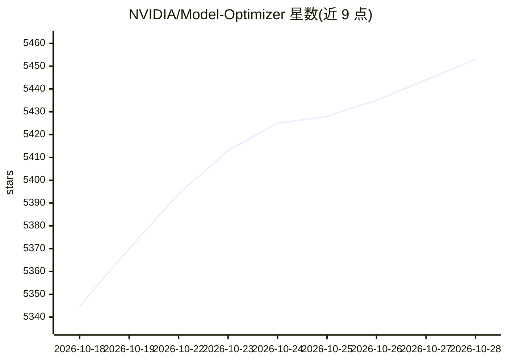

# NVIDIA/Model-Optimizer

⭐ 5,461 · Python · Apache-2.0 · 推送 2026-10-28 · [GitHub](https://github.com/NVIDIA/Model-Optimizer) · [官网](https://nvidia.github.io/Model-Optimizer/) · 组织维护

**NVIDIA 的模型压缩优化库：量化/剪枝/蒸馏加速推理部署**

面向深度学习开发者与企业的模型优化 Python 库，提供 PTQ/QAT、剪枝、蒸馏、稀疏化、投机解码与神经架构搜索等技术，读取 Hugging Face、PyTorch 或 ONNX 模型并导出量化 checkpoint，供 TensorRT-LLM、TensorRT、vLLM、SGLang 等下游推理框架部署；与 Megatron-Bridge、Megatron-LM、Hugging Face Accelerate 集成训练侧优化。通过 pip 安装，也可用预装 Model Optimizer 的 NVIDIA 容器镜像。项目处于 pre-1.0 阶段，废弃功能仅提供约 1 个月的迁移期。

## 筛选速览

| 维度 | 判定 | 备注 |
|---|---|---|
| AI 角色 | `ai-ecosystem` | LLM/agent 周边工具 |
| 许可风险 | `permissive` | Apache-2.0 |
| 部署形态 | `library` | 以包/库形式分发 |
| 模型依赖 | local-ok | 支持本地模型 |
| 硬件要求 | — | 无带数字的原话,不猜 |
| 安装摩擦 | `low` | 无编译、无系统依赖或容器化 |
| 成熟度 | `idea` | |

## 能力要点

- PTQ/QAT、剪枝、蒸馏、稀疏化、投机解码等优化技术组合
- 支持 Hugging Face / PyTorch / ONNX 模型输入并导出量化 checkpoint
- 产出可部署到 TensorRT-LLM / vLLM / SGLang 的预量化模型
- 提供 Claude Code / Codex 可安装的 agent skills

## 适用场景

- 把 Hugging Face 大模型量化压缩后部署到 TensorRT-LLM 或 vLLM
- 通过剪枝+蒸馏缩小模型体积、降低显存占用
- 在 NVIDIA 容器环境中直接使用预装的 Model Optimizer

## 场景标签

`模型量化` `微调` · 领域:训练与推理

## 证据(README 行号)

> L13: **NVIDIA Model Optimizer** (referred to as **Model Optimizer**, or **ModelOpt**) is a library comprising state-of-t
> L17: **[Optimize]** Model Optimizer provides Python APIs for users to easily compose the above model optimization techni
> L20: **[Export for deployment]** Seamlessly integrated within the NVIDIA AI software ecosystem, the quantized checkpoint

## 星数曲线

2026-10-18 5,345 → 2026-10-28 5,453（+108）

---
*卡片 v1 · prompt 1.4 · 生成 2026-10-20 · 置信度 high · 依据 README sha `5a76a2dea826` · [字段定义](../../DATASET.md)*
