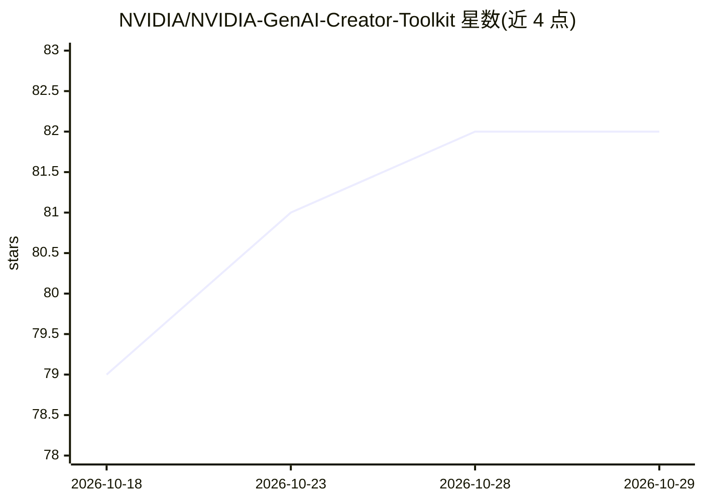

# NVIDIA/NVIDIA-GenAI-Creator-Toolkit

⭐ 82 · Python · NOASSERTION · 推送 2026-10-19 · [GitHub](https://github.com/NVIDIA/NVIDIA-GenAI-Creator-Toolkit) · 组织维护

**面向创作者的 ComfyUI 生成式 AI 工作流合集（3D 资产与视觉）**

NVIDIA 维护的 ComfyUI 预构建工作流合集，改编自 GTC 2026 DLI 课程。提供 8 个主模块加 2 个附加模块，覆盖提示词增强、图像分层、局部重绘、360° 全景、HDRI 生成、轨迹控制视频、视频风格化与图像转 3D 模型等；每个模块为独立管线，附带 ComfyUI JSON 与示例输入。通过 install.bat/install.sh 脚本下载模型并安装到已有 ComfyUI 环境，需 HuggingFace 账号与 NVIDIA RTX GPU，部分模型有许可门槛（Flux.1-dev、DINOv3）。

## 筛选速览

| 维度 | 判定 | 备注 |
|---|---|---|
| AI 角色 | `ai-native` | 本体是模型或模型工具 |
| 许可风险 | `none` | NOASSERTION |
| 部署形态 | `None` |  |
| 模型依赖 | local-ok | 支持本地模型 |
| 硬件要求 | — | 无带数字的原话,不猜 |
| 安装摩擦 | `medium` | 含编译或系统依赖之一 |
| 成熟度 | — | 结构信号不足 |

## 能力要点

- 8+2 个独立 ComfyUI 工作流，覆盖图像编辑、视频与 2D→3D
- 安装脚本自动下载模型并支持 --clean 清理
- 各模块标注 VRAM 与磁盘需求，模块间依赖关系明确
- 部分模块（05/08）需在 HuggingFace 接受受限模型许可

## 适用场景

- 创作者在 ComfyUI 中直接运行预构建的 3D/视觉生成管线
- 将 2D 参考图转为带 PBR 材质的 3D 模型
- 生成可控轨迹的视频与 HDRI 环境贴图
- 按需选择单个模块学习或用于设计可视化

## 场景标签

`图像生成` `视频生成` `图像视频处理` · 领域:内容生成

## 证据(README 行号)

> L6: **Achieve professional creative control over 3D assets and motion for visualization, powered by modular generative A
> L71: |01|LLM Prompt Enhancer|Gemma 3 via Ollama|24 / 32 GB|~65 GB|Build an AI agent that refines weak prompts into model

## 星数曲线

2026-10-18 79 → 2026-10-29 82（+3）

---
*卡片 v1 · prompt 1.4 · 生成 2026-10-24 · 置信度 high · 依据 README sha `439a93781d91` · [字段定义](../../DATASET.md)*
