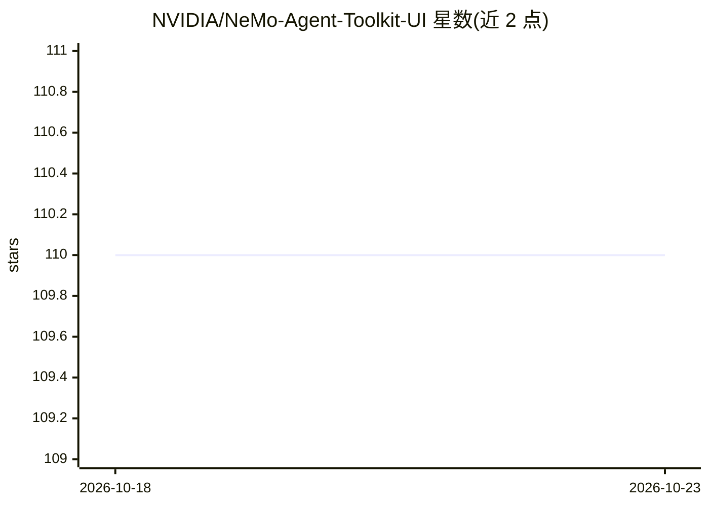

# NVIDIA/NeMo-Agent-Toolkit-UI

⭐ 110 · TypeScript · NOASSERTION · 推送 2026-10-18 · [GitHub](https://github.com/NVIDIA/NeMo-Agent-Toolkit-UI) · 组织维护

**NeMo Agent Toolkit 的官方 Web 前端：聊天界面运行 agent 工作流**

NVIDIA 维护的开源 Web UI，作为 NeMo Agent Toolkit（构建 AI agent 与工作流的库）的官方前端组件。提供聊天界面、流式响应、中间推理步骤展示、Human-in-the-Loop 交互（需 WebSocket 模式）、欢迎语与提示建议自定义。通过统一代理架构经环境变量配置，支持 HTTP（OpenAI Chat Completions 兼容）与 WebSocket 两种通信模式，可用 npm 本地开发或 Docker 构建部署。基于 chatbot-ui 与 chatbot-ollama 二次开发。运行前提是已安装并配置 NeMo Agent Toolkit 后端。

## 筛选速览

| 维度 | 判定 | 备注 |
|---|---|---|
| AI 角色 | `ai-ecosystem` | LLM/agent 周边工具 |
| 许可风险 | `none` | NOASSERTION |
| 部署形态 | `self-host` | docker 或自建部署 |
| 模型依赖 | — | README 未给出锁定关系 |
| 硬件要求 | — | 无带数字的原话,不猜 |
| 安装摩擦 | `low` | 无编译、无系统依赖或容器化 |
| 成熟度 | `idea` | |

## 能力要点

- 实时流式响应与 agent 中间推理步骤可视化
- Human-in-the-Loop 工作流（WebSocket 双向通信）
- OpenAI Chat Completions 兼容的 HTTP 与 WebSocket 双模式
- 欢迎语、提示建议、主题等通过环境变量与 JSON/Markdown 文件自定义

## 适用场景

- 为 NeMo Agent Toolkit 后端工作流提供可视化聊天前端
- 在 agent 执行中通过弹窗进行人工介入确认
- 实时查看 agent 的中间推理步骤与数据流

## 场景标签

`聊天机器人` · 领域:对话与助手

## 证据(README 行号)

> L6: This is the official frontend user interface component for NeMo Agent Toolkit, an open-source library for building A
> L27: - NeMo Agent Toolkit installed and configured

## 星数曲线

2026-10-18 110 → 2026-10-23 110（+0）

---
*卡片 v1 · prompt 1.4 · 生成 2026-10-23 · 置信度 high · 依据 README sha `5fb6fe5ec0d9` · [字段定义](../../DATASET.md)*
