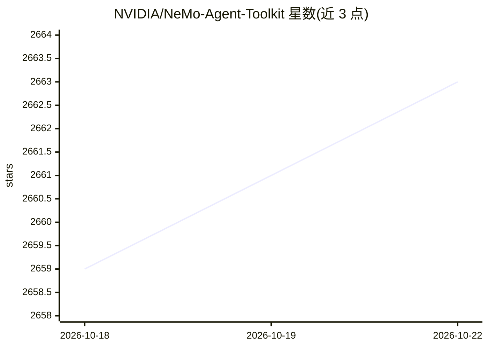

# NVIDIA/NeMo-Agent-Toolkit

⭐ 2,663 · Python · Apache-2.0 · 推送 2026-10-21 · [GitHub](https://github.com/NVIDIA/NeMo-Agent-Toolkit) · [官网](https://docs.nvidia.com/nemo/agent-toolkit/latest/) · 组织维护

**NVIDIA 开源 AI agent 开发与优化工具包**

面向 agent 开发者的 Python 库（包名 nvidia-nat），提供框架无关的 agent 构建、观测、性能分析与优化能力：支持与 LangChain、LlamaIndex、CrewAI、Semantic Kernel、Google ADK 等框架配合使用；含 token 级 profiling、离线评测、超参数与提示词优化、基于强化学习的 LLM 微调（实验性）、MCP 与 A2A 协议支持、工作流发布为 MCP server，及内置聊天 UI 与 nat CLI。通过 PyPI 安装，需 Python 3.11–3.13；CLI 含 opt-in 遥测。由 NVIDIA 维护。

## 筛选速览

| 维度 | 判定 | 备注 |
|---|---|---|
| AI 角色 | `ai-ecosystem` | LLM/agent 周边工具 |
| 许可风险 | `permissive` | Apache-2.0 |
| 部署形态 | `library` | 以包/库形式分发 |
| 模型依赖 | — | README 未给出锁定关系 |
| 硬件要求 | — | 无带数字的原话,不猜 |
| 安装摩擦 | `low` | 无编译、无系统依赖或容器化 |
| 成熟度 | — | 结构信号不足 |

## 能力要点

- 框架无关：与 LangChain/CrewAI/Semantic Kernel/Google ADK 等协同的插桩与优化
- agent 级到 token 级 profiling 与生产可观测性
- 离线评测、超参数/提示词自动优化、RL 微调 LLM
- MCP 工具集成与服务化、A2A 分布式 agent 协议支持

## 适用场景

- 为生产环境 agent 添加观测、profiling 与评测
- 跨框架构建和复用 agent 组件与工作流
- 将 agent 工作流发布为 MCP server 供他人调用

## 场景标签

`Agent 框架` `LLM 可观测性` `模型评测` `提示工程` · 领域:Agent 开发

## 证据(README 行号)

> L15: *NVIDIA NeMo Agent Toolkit adds intelligence to AI agents across any framework—enhancing speed, accuracy, and decis
> L30:  - 🧩 **Framework Agnostic:** Work side-by-side with agentic frameworks to add the instrumentation necessary for obs
> L38:  - 🧪 **Evaluation System:** Validate and maintain accuracy of agentic workflows with a suite of tools for offline e

## 星数曲线

2026-10-18 2,659 → 2026-10-22 2,663（+4）

---
*卡片 v1 · prompt 1.4 · 生成 2026-10-21 · 置信度 high · 依据 README sha `a2ff090a8907` · [字段定义](../../DATASET.md)*
