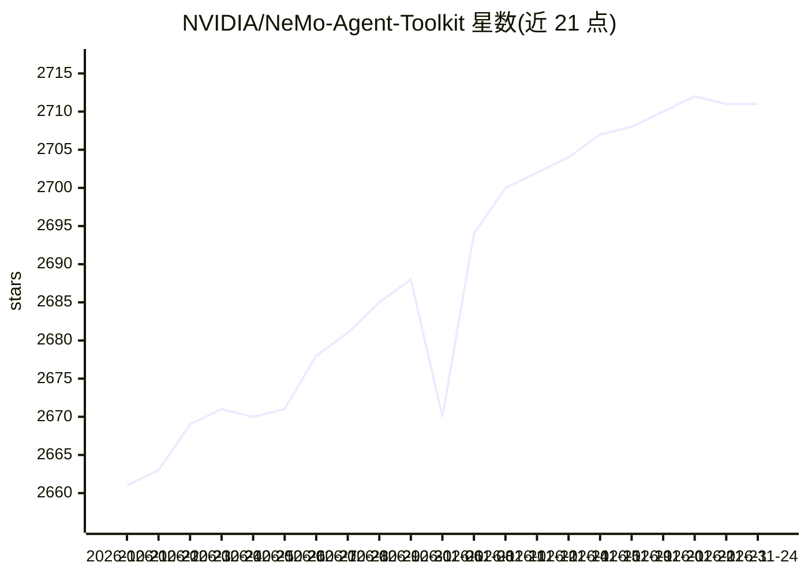

# NVIDIA/NeMo-Agent-Toolkit

⭐ 2,711 · Python · Apache-2.0 · 推送 2026-11-20 · [GitHub](https://github.com/NVIDIA/NeMo-Agent-Toolkit) · [官网](https://docs.nvidia.com/nemo/agent-toolkit/latest/) · 组织维护

**为开发者提供连接与优化多 AI agent 团队的开源工具包**

NVIDIA 出品的开源库（Apache 2.0），用于连接与优化 AI agent 团队：提供框架无关的插桩层，可搭配 LangChain、LlamaIndex、CrewAI、Microsoft Semantic Kernel、Google ADK 等框架；内置工作流剖析、可观测性、离线评估、超参与 prompt 优化器、强化学习微调，支持 MCP 与 A2A 协议，附带聊天 UI 与 nat CLI。注意 README 顶部声明该工具包已弃用，2026 年底 EOL，需迁移至 NeMo Relay/Helix/Fabric。

## 筛选速览

| 维度 | 判定 | 备注 |
|---|---|---|
| AI 角色 | `ai-ecosystem` | LLM/agent 周边工具 |
| 许可风险 | `permissive` | Apache-2.0 |
| 部署形态 | `library` | 以包/库形式分发 |
| 模型依赖 | — | README 未给出锁定关系 |
| 硬件要求 | — | 无带数字的原话,不猜 |
| 安装摩擦 | `low` | 无编译、无系统依赖或容器化 |
| 成熟度 | — | 结构信号不足 |

## 能力要点

- 框架无关插桩：搭配 LangChain、LlamaIndex、CrewAI、Semantic Kernel、Google ADK 等使用
- 从 agent 级到 token 级的工作流剖析与可观测性
- 离线评估系统、超参/prompt 自动优化、强化学习微调
- 支持 MCP 与 A2A 协议，可经 FastMCP 将工作流发布为 MCP 服务器

## 适用场景

- 为已有的 agent 工作流添加性能剖析与执行追踪
- 对 agent 应用做离线评估并自动优化 prompt 配置
- 把自建 agent 工具以 MCP 服务器形式对外提供

## 场景标签

`Agent 框架` `LLM 可观测性` `模型评测` · 领域:Agent 开发

## 证据(README 行号)

> L19: *NVIDIA NeMo Agent Toolkit adds intelligence to AI agents across any framework—enhancing speed, accuracy, and decis
> L34:  - 🧩 **Framework Agnostic:** Work side-by-side with agentic frameworks to add the instrumentation necessary for obs
> L41: - 🚀 **Agent Optimization:** Improve your agent's quality, accuracy, and performance with a suite of tools for all p

## 星数曲线

2026-10-21 2,661 → 2026-11-24 2,711（+50）

---
*卡片 v1 · prompt 1.4 · 生成 2026-11-23 · 置信度 high · 依据 README sha `c92faeb87835` · [字段定义](../../DATASET.md)*
