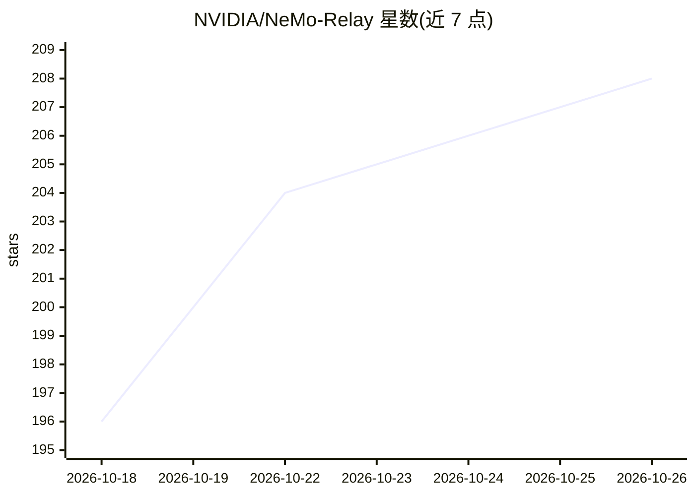

# NVIDIA/NeMo-Relay

⭐ 208 · Rust · Apache-2.0 · 推送 2026-10-25 · [GitHub](https://github.com/NVIDIA/NeMo-Relay) · [官网](https://docs.nvidia.com/nemo/relay) · 组织维护

**多语言 agent 运行时库：管理工具与 LLM 调用的作用域、生命周期与中间件**

NVIDIA 维护的 agent 运行时与库，为编码 agent、应用、框架集成与可观测性后端提供共享运行时：管理运行/轮次/工具/LLM 调用的作用域与父子血缘，在调用边界应用统一的生命周期与中间件规则（拦截、改写、路由、重试），通过插件启用可观测性与导出器，输出 ATOF 原始事件、ATIF 轨迹与 OpenTelemetry 数据。提供 CLI 包装 Codex/Claude Code 等编码 agent，Python/Node.js/Rust 绑定完整支持，Go 与 FFI 为实验性。

## 筛选速览

| 维度 | 判定 | 备注 |
|---|---|---|
| AI 角色 | `ai-ecosystem` | LLM/agent 周边工具 |
| 许可风险 | `permissive` | Apache-2.0 |
| 部署形态 | `library` | 以包/库形式分发 |
| 模型依赖 | — | README 未给出锁定关系 |
| 硬件要求 | — | 无带数字的原话,不猜 |
| 安装摩擦 | `low` | 无编译、无系统依赖或容器化 |
| 成熟度 | `idea` | |

## 能力要点

- 作用域/血缘/清理边界管理，覆盖运行、轮次、工具、LLM 调用与子 agent
- LLM 与工具调用的托管中间件（block/改写/路由/重试/替换）
- 同一运行时流导出 ATOF、ATIF 与 OpenTelemetry 轨迹/日志/指标
- CLI 透明包装 Claude Code、Codex 等 agent harness，无需改动现有技术栈

## 适用场景

- 本地录制 Codex 或 Claude Code 的 agent 运行轨迹并排查问题
- 为 LangChain/LangGraph/Deep Agents 应用注入统一的调用边界与可观测性
- 打包可复用的中间件、护栏或导出器插件

## 场景标签

`Agent 框架` `LLM 可观测性` · 领域:Agent 开发

## 证据(README 行号)

> L14: NVIDIA NeMo Relay provides visibility into and control over agent runs without
> L219: Relay connects agent systems. A production application can
> L239: Relay does not replace frameworks, model provider, application logic,

## 星数曲线

2026-10-18 196 → 2026-10-26 208（+12）

---
*卡片 v1 · prompt 1.4 · 生成 2026-10-22 · 置信度 high · 依据 README sha `d7dd326b688a` · [字段定义](../../DATASET.md)*
