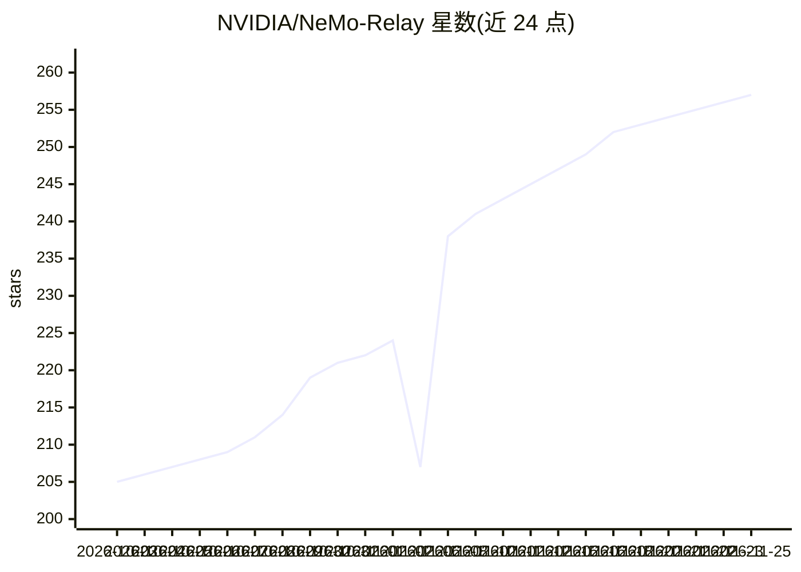

# NVIDIA/NeMo-Relay

⭐ 257 · Rust · Apache-2.0 · 推送 2026-11-24 · [GitHub](https://github.com/NVIDIA/NeMo-Relay) · [官网](https://docs.nvidia.com/nemo/relay) · 组织维护

**给 agent 模型/工具调用加观测、管控与中间件的运行时库**

NVIDIA 开源的 agent 运行时库，将 agent 的模型调用与工具调用包进统一的运行时契约，提供作用域管理、生命周期事件与中间件。通过 CLI 附加到已支持的编码 agent，或通过 Python/Node.js/Rust SDK 嵌入自有代码；中间件可在调用执行前拦截、净化、脱敏或改写。输出统一事件流，可导出为 ATOF、ATIF、OpenTelemetry 或 OpenInference 格式。以插件机制启用可观测性、PII 脱敏、模型计价与自适应调优。目前为 beta 软件，API 与行为可能随版本变化。

## 筛选速览

| 维度 | 判定 | 备注 |
|---|---|---|
| AI 角色 | `ai-ecosystem` | LLM/agent 周边工具 |
| 许可风险 | `permissive` | Apache-2.0 |
| 部署形态 | `library` | 以包/库形式分发 |
| 模型依赖 | — | README 未给出锁定关系 |
| 硬件要求 | — | 无带数字的原话,不猜 |
| 安装摩擦 | `low` | 无编译、无系统依赖或容器化 |
| 成熟度 | `idea` | |

## 能力要点

- 在调用执行前施加中间件策略（阻断/净化/脱敏/改写）
- 统一事件流导出 ATOF/ATIF/OpenTelemetry/OpenInference
- Python、Node.js、Rust SDK 及 CLI，插件经 plugins.toml 启用
- 模型计价估算每次调用成本，自适应插件调整缓存与请求提示

## 适用场景

- 观测本地编码 agent 的模型与工具调用轨迹
- 在企业 agent 中对工具调用执行安全与合规策略
- 评估 agent harness 改动对行为的影响
- 估算并调优 agent 运行的成本与延迟

## 场景标签

`LLM 可观测性` · 领域:评测与运维

## 证据(README 行号)

> L14: NVIDIA NeMo Relay is a library that wraps your agents' model and
> L22: - **Enforce policy at the call.** Middleware and guardrails can block,
> L71: runtime contract for scopes, policy, plugins, and lifecycle events, instead of

## 星数曲线

2026-10-23 205 → 2026-11-25 257（+52）

---
*卡片 v1 · prompt 1.4 · 生成 2026-11-25 · 置信度 mid · 依据 README sha `31dceead7175` · [字段定义](../../DATASET.md)*
