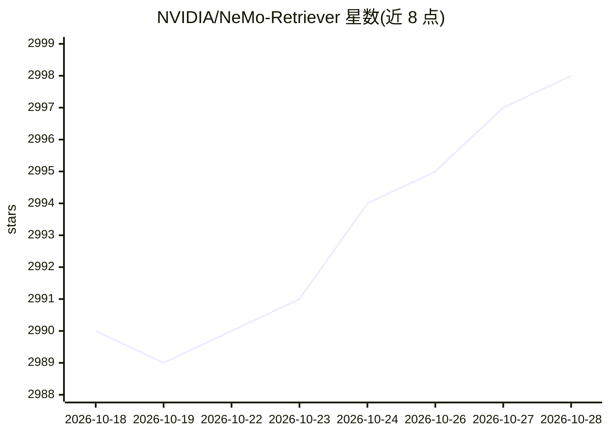

# NVIDIA/NeMo-Retriever

⭐ 2,998 · Python · Apache-2.0 · 推送 2026-10-27 · [GitHub](https://github.com/NVIDIA/NeMo-Retriever) · [官网](https://nvidia.github.io/NeMo-Retriever/) · 组织维护

**面向 RAG 的文档内容抽取与嵌入微服务框架**

NVIDIA 维护的可扩展文档抽取框架：将文档分页并行处理，分类并抽取文本、表格、图表与信息图，经 OCR 上下文化为 JSON schema，随后计算嵌入并存入 LanceDB，供下游生成式与 RAG 应用使用。支持 NVIDIA NIM 微服务及 HuggingFace 本地 GPU 模型两种路径；小规模（<100 PDF）可用开发中的 Python 库，生产部署走 Kubernetes Helm 图表或 Docker 服务镜像。默认嵌入模型为 Nemotron-3-Embed-1B-BF16（OpenMDW 许可）。README 声明 legacy ingestion API 正在逐步淘汰。

## 筛选速览

| 维度 | 判定 | 备注 |
|---|---|---|
| AI 角色 | `ai-ecosystem` | LLM/agent 周边工具 |
| 许可风险 | `permissive` | Apache-2.0 |
| 部署形态 | `library` | 以包/库形式分发 |
| 模型依赖 | — | README 未给出锁定关系 |
| 硬件要求 | — | 无带数字的原话,不猜 |
| 安装摩擦 | `low` | 无编译、无系统依赖或容器化 |
| 成熟度 | `idea` | |

## 能力要点

- 分页并行抽取文本/表格/图表/信息图并输出 JSON schema
- 嵌入计算与 LanceDB 存储集成
- 支持 NVIDIA NIM 微服务与 HuggingFace 本地 GPU 模型
- Kubernetes Helm 生产部署与独立 Docker 服务镜像

## 适用场景

- 为 RAG 应用做大规模 PDF/文档解析与嵌入入库
- 查询已摄取内容并结合 LLM 生成回答
- 将抽取结果接入 llama-index 或 langchain 检索管线

## 场景标签

`文档解析` `RAG` · 领域:知识与检索

## 证据(README 行号)

> L9: NeMo Retriever Library is a scalable, performance-oriented framework for document content and metadata extraction. I
> L14: NeMo Retriever Library enables parallelization of splitting documents into pages where artifacts are classified (su

## 星数曲线

2026-10-18 2,990 → 2026-10-28 2,998（+8）

---
*卡片 v1 · prompt 1.4 · 生成 2026-10-20 · 置信度 high · 依据 README sha `0d89776677b0` · [字段定义](../../DATASET.md)*
