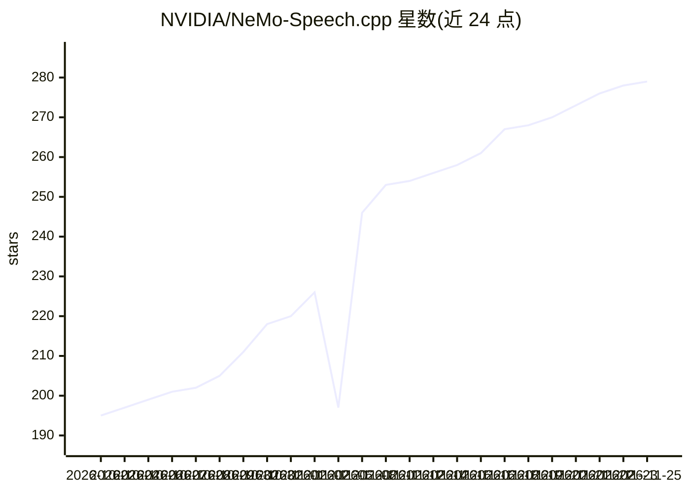

# NVIDIA/NeMo-Speech.cpp

⭐ 279 · C++ · Apache-2.0 · 推送 2026-11-22 · [GitHub](https://github.com/NVIDIA/NeMo-Speech.cpp) · 组织维护

**NVIDIA Nemotron 语音模型家族的本地 C++ 推理运行时**

NVIDIA 官方的本地语音推理运行时，基于 ggml 原生实现，覆盖 Nemotron/Parakeet 语音家族模型：语音识别、转录（词级时间戳、说话人标签）、说话人分离、翻译、语音合成、全双工语音对话及 VAD 等语音处理。提供 CLI 与本地 HTTP 服务两种形态，服务端暴露 OpenAI 兼容子集与 WebSocket 实时转录，另含 C 头文件与 CMake 包形式的 SDK。支持 CUDA、CPU、Metal、Vulkan 等后端；源码构建需 CMake 3.26+、Ninja、C++17 编译器与 SentencePiece 开发文件。

## 筛选速览

| 维度 | 判定 | 备注 |
|---|---|---|
| AI 角色 | `ai-native` | 本体是模型或模型工具 |
| 许可风险 | `permissive` | Apache-2.0 |
| 部署形态 | `None` |  |
| 模型依赖 | local-ok | 支持本地模型 |
| 硬件要求 | — | 无带数字的原话,不猜 |
| 安装摩擦 | `high` | 编译与系统依赖俱全 |
| 成熟度 | `idea` | |

## 能力要点

- 支持 ASR、转录、说话人分离、翻译、TTS、全双工 VoiceChat 与 VAD 等语音处理
- 160 ms 分块的流式识别与合成均可在 CPU 上快于实时运行（README 性能表数据）
- 本地 HTTP 服务暴露 OpenAI 兼容接口与实时 WebSocket 转录，另提供 Riva 兼容 gRPC 二进制
- 发布包含稳定 C 头文件、共享库与导出的 CMake 包

## 适用场景

- 在本地或边缘设备上离线运行 Nemotron 语音识别与合成模型
- 为应用接入实时流式转录或语音对话服务
- 将自有 NeMo/Hugging Face 语音检查点转换为 GGUF 后本地推理

## 场景标签

`语音识别` `语音合成` `语音 Agent` `推理引擎` · 领域:对话与助手

## 证据(README 行号)

> L3:  A lightweight native C++ runtime for the NVIDIA Nemotron Speech model family, with broad hardware support.
> L16: |Speech recognition|Nemotron 3.5 ASR Streaming 0.6B, Nemotron Speech Streaming 0.6B, Parakeet TDT 0.6B v3, and Para
> L130: The server binds to <http://127.0.0.1:8080> by default. Its transcription and

## 星数曲线

2026-10-22 195 → 2026-11-25 279（+84）

---
*卡片 v1 · prompt 1.4 · 生成 2026-11-25 · 置信度 high · 依据 README sha `2d1291991435` · [字段定义](../../DATASET.md)*
