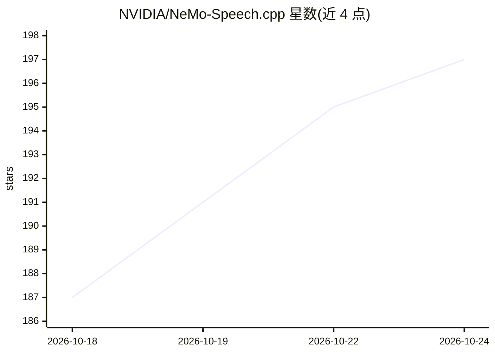

# NVIDIA/NeMo-Speech.cpp

⭐ 197 · C++ · Apache-2.0 · 推送 2026-10-20 · [GitHub](https://github.com/NVIDIA/NeMo-Speech.cpp) · 组织维护

**NVIDIA 语音模型家族的本地 C++ 推理运行时与 CLI**

NVIDIA 官方的轻量本地语音推理运行时，基于 ggml，运行 Nemotron/Parakeet/MagpieTTS 等 NeMo 语音模型：支持语音识别（流式转写）、说话人分离、语音/文本翻译、语音合成与全双工语音对话。提供 nemo-speech CLI、本地 HTTP 服务（含 OpenAI 兼容接口与 playground）、Riva 兼容 gRPC 服务及 C/C++ 原生 SDK。支持 CUDA、CPU、Metal、Vulkan 后端；安装脚本下载预编译二进制，也可从源码构建（需 CMake 3.26+、Ninja、C++17 编译器、SentencePiece 开发文件）。

## 筛选速览

| 维度 | 判定 | 备注 |
|---|---|---|
| AI 角色 | `ai-native` | 本体是模型或模型工具 |
| 许可风险 | `permissive` | Apache-2.0 |
| 部署形态 | `None` |  |
| 模型依赖 | local-ok | 支持本地模型 |
| 硬件要求 | — | 无带数字的原话,不猜 |
| 安装摩擦 | `high` | 编译与系统依赖俱全 |
| 成熟度 | — | 结构信号不足 |

## 能力要点

- 流式语音识别按 160ms 分块转写，支持说话人分离、翻译、TTS 与全双工 VoiceChat
- 提供 CLI、本地 HTTP 服务（OpenAI 兼容子集）、Riva 兼容 gRPC 服务与 C/C++ 原生 SDK
- 安装脚本下载预编译二进制并做 SHA-256 校验，无预编译时自动源码构建
- 支持 CUDA、CPU、Metal、Vulkan 等后端

## 适用场景

- 在本地离线转写 WAV 文件或麦克风流式音频
- 部署本地 OpenAI 兼容的转写/合成 HTTP 服务
- 将 ASR/TTS 能力以 C/C++ SDK 形式嵌入应用

## 场景标签

`语音识别` `语音合成` `推理引擎` · 领域:内容生成

## 证据(README 行号)

> L7: > **NeMo-Speech.cpp is NVIDIA's official solution for local speech inference**,
> L16: |Speech recognition|Nemotron 3.5 ASR Streaming 0.6B, Nemotron Speech Streaming 0.6B, Parakeet TDT 0.6B v3, and Para
> L89: nemo-speech transcribe /path/to/audio.wav

## 星数曲线

2026-10-18 187 → 2026-10-24 197（+10）

---
*卡片 v1 · prompt 1.4 · 生成 2026-10-22 · 置信度 high · 依据 README sha `a1fdcd68c082` · [字段定义](../../DATASET.md)*
