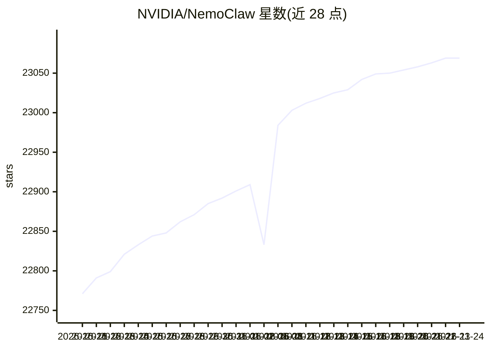

# NVIDIA/NemoClaw

⭐ 23,069 · TypeScript · Apache-2.0 · 推送 2026-11-22 · [GitHub](https://github.com/NVIDIA/NemoClaw) · [官网](https://docs.nvidia.com/nemoclaw/latest/) · 组织维护

**在 NVIDIA OpenShell 沙箱中更安全运行 AI agent 的参考栈**

NVIDIA 开源的参考技术栈，用于在 OpenShell 沙箱内以受控方式运行受支持的 AI agent（OpenClaw、Hermes、LangChain Deep Agents Code）。通过 NemoClaw CLI 及各 agent 专属别名提供引导式上手、托管推理、网络策略、托管集成、OpenShell 支撑的状态持久化与生命周期操作。支持快速安装模式与交互式选择 agent、沙箱名、推理提供方与模型；通过私嵌渠道接收漏洞报告，采用 Apache 2.0 许可。README 未列具体功能清单，需查阅官方文档。

## 筛选速览

| 维度 | 判定 | 备注 |
|---|---|---|
| AI 角色 | `ai-ecosystem` | LLM/agent 周边工具 |
| 许可风险 | `permissive` | Apache-2.0 |
| 部署形态 | `None` |  |
| 模型依赖 | — | README 未给出锁定关系 |
| 硬件要求 | — | 无带数字的原话,不猜 |
| 安装摩擦 | `low` | 无编译、无系统依赖或容器化 |
| 成熟度 | — | 结构信号不足 |

## 动量与使用信号

- 维护:`active` — 距上次 push 0.7 天,年发版 1,185 位贡献者
- 涨星:近 1 天 **+5**(自 20261016 起算)
- 平台:WINDOWS / LINUX · 协议:—

## 能力要点

- 提供 CLI 与 agent 专属别名管理沙箱内 agent 的生命周期
- 托管推理与可路由的推理提供方配置
- 网络策略与沙箱加固等安全控制层
- OpenShell 支撑的状态持久化与托管集成

## 适用场景

- 在受控沙箱中运行 OpenClaw 等编码/对话 agent
- 为 agent 配置出网策略与安全加固
- 统一管理多个 agent 框架的沙箱与推理接入

## 场景标签

 · 领域:AI 基础设施/Agent 运行时

## 证据(README 行号)

> L12: NVIDIA NemoClaw is an open source reference stack for running supported AI agents more safely inside NVIDIA OpenShe
> L13: It provides guided onboarding, managed inference, network policy, managed integrations, OpenShell-backed state pers
> L17: - OpenClaw (default)
> L18: - Hermes
> L19: - LangChain Deep Agents Code

## 星数曲线

2026-10-21 22,771 → 2026-11-24 23,069（+298）

---
*卡片 v1 · prompt 1.4 · 生成 2026-11-22 · 置信度 high · 依据 README sha `e6564df4b5f0` · [字段定义](../../DATASET.md)*
