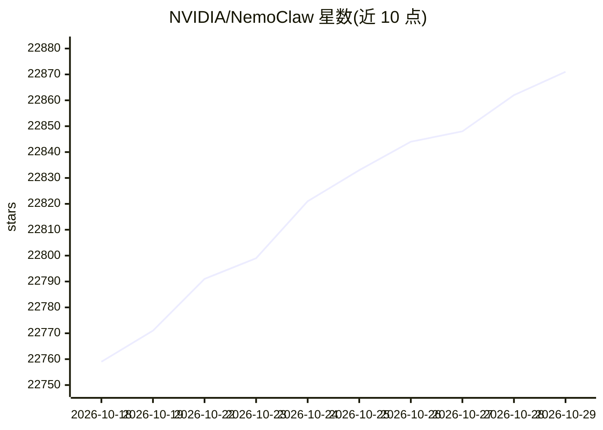

# NVIDIA/NemoClaw

⭐ 22,871 · TypeScript · Apache-2.0 · 推送 2026-10-28 · [GitHub](https://github.com/NVIDIA/NemoClaw) · [官网](https://docs.nvidia.com/nemoclaw/latest/) · 组织维护

**在 NVIDIA OpenShell 沙箱中更安全运行 AI agent 的参考栈**

NVIDIA 开源的参考栈，将 OpenClaw、Hermes、LangChain Deep Agents Code 三种 AI agent 运行在 OpenShell 沙箱内，通过 NemoClaw CLI 及其 agent 专属别名提供引导式上手、托管推理、网络策略、托管集成、沙箱化状态持久化与生命周期操作。安装器支持在 DGX 或 WSL 主机上以推荐预设快速安装，也可交互式选择 agent、沙箱名称、推理提供商与模型。官方文档另覆盖沙箱加固与网络安全最佳实践。

## 筛选速览

| 维度 | 判定 | 备注 |
|---|---|---|
| AI 角色 | `ai-ecosystem` | LLM/agent 周边工具 |
| 许可风险 | `permissive` | Apache-2.0 |
| 部署形态 | `None` |  |
| 模型依赖 | — | README 未给出锁定关系 |
| 硬件要求 | — | 无带数字的原话,不猜 |
| 安装摩擦 | `low` | 无编译、无系统依赖或容器化 |
| 成熟度 | — | 结构信号不足 |

## 动量与使用信号

- 维护:`active` — 距上次 push 0.7 天,年发版 1,185 位贡献者
- 涨星:近 1 天 **+5**(自 20261016 起算)
- 平台:WINDOWS / LINUX · 协议:—

## 能力要点

- 支持 OpenClaw（默认）、Hermes、LangChain Deep Agents Code 三种 agent
- 托管推理与可配置网络策略、出口控制
- OpenShell 沙箱隔离与加固（能力裁剪、进程限制）
- CLI 交互式选择沙箱名称、推理提供商与模型

## 适用场景

- 在沙箱环境中运行 OpenClaw 或 Hermes agent
- 为本地编码 agent（Cursor、Claude Code、Codex、Copilot）生成安装 NemoClaw 的引导提示词
- 按网络策略控制 agent 的出口流量与集成权限

## 场景标签

`网络安全` · 领域:学习与行业

## 证据(README 行号)

> L7: NVIDIA NemoClaw is an open source reference stack for running supported AI agents more safely inside NVIDIA OpenShel
> L8: It provides guided onboarding, managed inference, network policy, managed integrations, OpenShell-backed state persi
> L12: - OpenClaw (default)

## 星数曲线

2026-10-18 22,759 → 2026-10-29 22,871（+112）

---
*卡片 v1 · prompt 1.4 · 生成 2026-10-18 · 置信度 high · 依据 README sha `eec3c2065100` · [字段定义](../../DATASET.md)*
