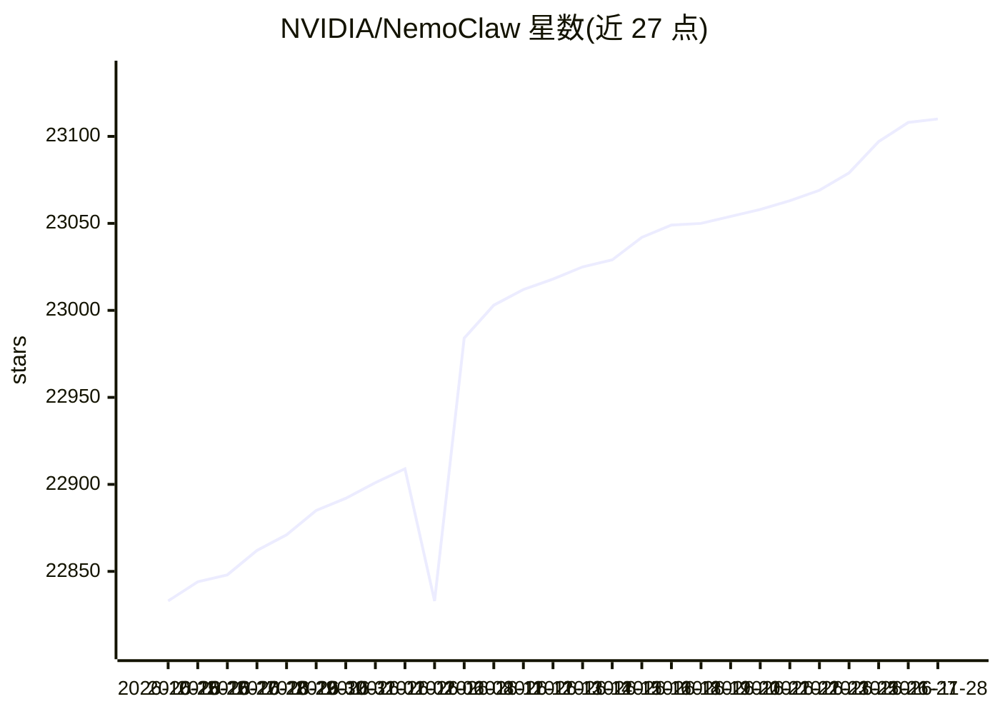

# NVIDIA/NemoClaw

⭐ 23,110 · TypeScript · Apache-2.0 · 推送 2026-11-27 · [GitHub](https://github.com/NVIDIA/NemoClaw) · [官网](https://docs.nvidia.com/nemoclaw/latest/) · 组织维护

**在 NVIDIA OpenShell 沙箱中更安全运行 AI agent 的参考栈**

NVIDIA 开源的参考技术栈，用于在 OpenShell 沙箱内运行受支持的 AI agent（OpenClaw、Hermes、LangChain Deep Agents Code）。通过 NemoClaw CLI 与 agent 专属别名提供引导式上手、托管推理、网络策略、托管集成、基于 OpenShell 的状态持久化和生命周期操作。新版 Agent Configs 为推荐配置方式，旧体验仍可用并提供迁移指南。当前优先方向包括安装可靠性、沙箱加固、凭据处理与网络策略默认值。

## 筛选速览

| 维度 | 判定 | 备注 |
|---|---|---|
| AI 角色 | `ai-ecosystem` | LLM/agent 周边工具 |
| 许可风险 | `permissive` | Apache-2.0 |
| 部署形态 | `None` |  |
| 模型依赖 | — | README 未给出锁定关系 |
| 硬件要求 | — | 无带数字的原话,不猜 |
| 安装摩擦 | `low` | 无编译、无系统依赖或容器化 |
| 成熟度 | — | 结构信号不足 |

## 动量与使用信号

- 维护:`active` — 距上次 push 0.7 天,年发版 1,185 位贡献者
- 涨星:近 1 天 **+5**(自 20261016 起算)
- 平台:WINDOWS / LINUX · 协议:—

## 能力要点

- 支持 OpenClaw（默认）、Hermes、LangChain Deep Agents Code 三类 agent
- 提供托管推理、网络策略与出口控制等安全层
- 基于 OpenShell 的沙箱状态持久化与生命周期操作
- 终端交互式安装器支持 DGX/WSL 平台预设

## 适用场景

- 在沙箱中运行 OpenClaw 等 agent 并限制网络出口
- 为 agent 统一配置推理提供方与模型
- 按安全最佳实践加固 agent 沙箱环境

## 场景标签

 · 领域:LLM 基础设施/agent 运行与安全

## 证据(README 行号)

> L12: NVIDIA NemoClaw is an open source reference stack for running supported AI agents more safely inside NVIDIA OpenShe
> L13: It provides guided onboarding, managed inference, network policy, managed integrations, OpenShell-backed state pers

## 星数曲线

2026-10-25 22,833 → 2026-11-28 23,110（+277）

---
*卡片 v1 · prompt 1.4 · 生成 2026-11-26 · 置信度 high · 依据 README sha `051b3097ec00` · [字段定义](../../DATASET.md)*
