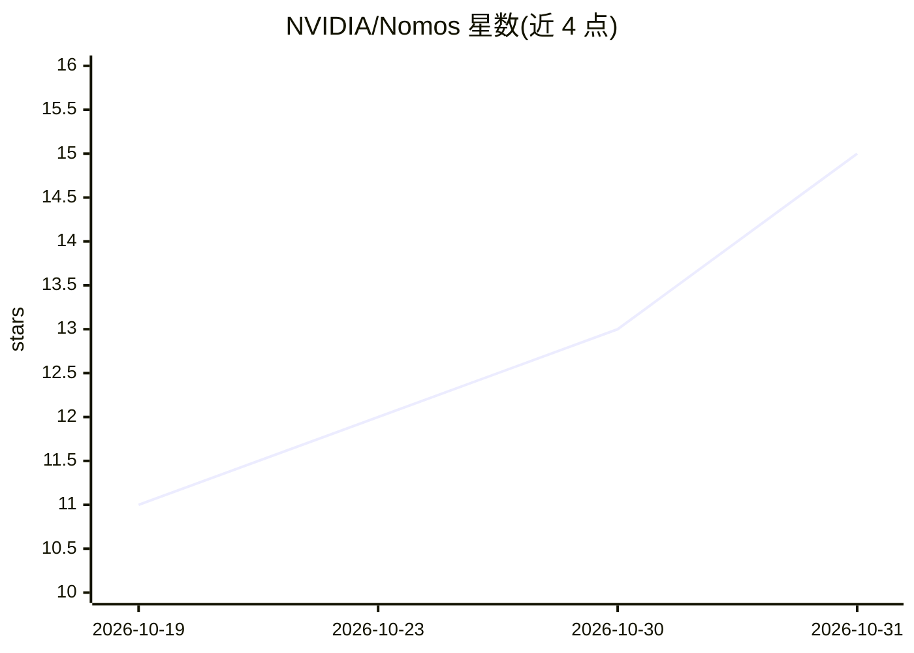

# NVIDIA/Nomos

⭐ 15 · Python · Apache-2.0 · 推送 2026-10-30 · [GitHub](https://github.com/NVIDIA/Nomos) · 组织维护

**给企业开发者的 AI agent 特权操作授权与审计层**

NVIDIA 维护的 agent 行为治理系统：agent 提出的特权操作（运行命令、修改基础设施、访问数据）需经多层独立审查方可执行——OPA 确定性策略过滤、多成员 LLM 议会投票（默认经 NVIDIA API Catalog NIM 端点，可选 Anthropic/OpenAI 直连）、Ed25519 签名的限时单次 Writ of Execution，以及带工具白名单与路径限制的容器沙箱执行器。全过程记录于哈希链签名账本。通过 Kind（Kubernetes）或 Docker Compose 部署，支持 Linux，macOS 原生部署不支持。

## 筛选速览

| 维度 | 判定 | 备注 |
|---|---|---|
| AI 角色 | `ai-ecosystem` | LLM/agent 周边工具 |
| 许可风险 | `permissive` | Apache-2.0 |
| 部署形态 | `self-host` | docker 或自建部署 |
| 模型依赖 | — | README 未给出锁定关系 |
| 硬件要求 | — | 无带数字的原话,不猜 |
| 安装摩擦 | `low` | 无编译、无系统依赖或容器化 |
| 成熟度 | — | 结构信号不足 |

## 能力要点

- OPA 策略 + LLM 议会 + 签名执行令牌 + 沙箱执行器的四层纵深防御
- Ed25519 签名、限时、单次使用的 Writ of Execution 与防重放 nonce
- 哈希链签名账本记录提交/评估/投票/铸造/执行全过程
- 支持 MCP over Streamable HTTP、gRPC 代理与自定义 OPA 策略

## 适用场景

- 让 Windsurf/Cursor/Copilot 等 IDE agent 的 shell 命令先经议会审查再执行
- 为生产部署、数据库迁移等 CI/CD 操作设置审批关卡
- 多 agent 系统中以密码学授权证明请求特权操作
- 测试 LLM 审查者对越狱与社会工程攻击的处理

## 场景标签

`LLM 可观测性` · 领域:评测与运维

## 证据(README 行号)

> L16: **Security Council + Writ of Execution + Sandboxed Execution.** Nomos is an authorization kernel for privileged ope
> L18: Nomos solves a specific problem: **how do you let AI agents take real actions (run commands, modify infrastructure,
> L41: - **IDE agent governance** — Route Windsurf/Cursor/Copilot shell commands through the council before execution

## 星数曲线

2026-10-19 11 → 2026-10-31 15（+4）

---
*卡片 v1 · prompt 1.4 · 生成 2026-10-31 · 置信度 mid · 依据 README sha `5e29a10f9663` · [字段定义](../../DATASET.md)*
