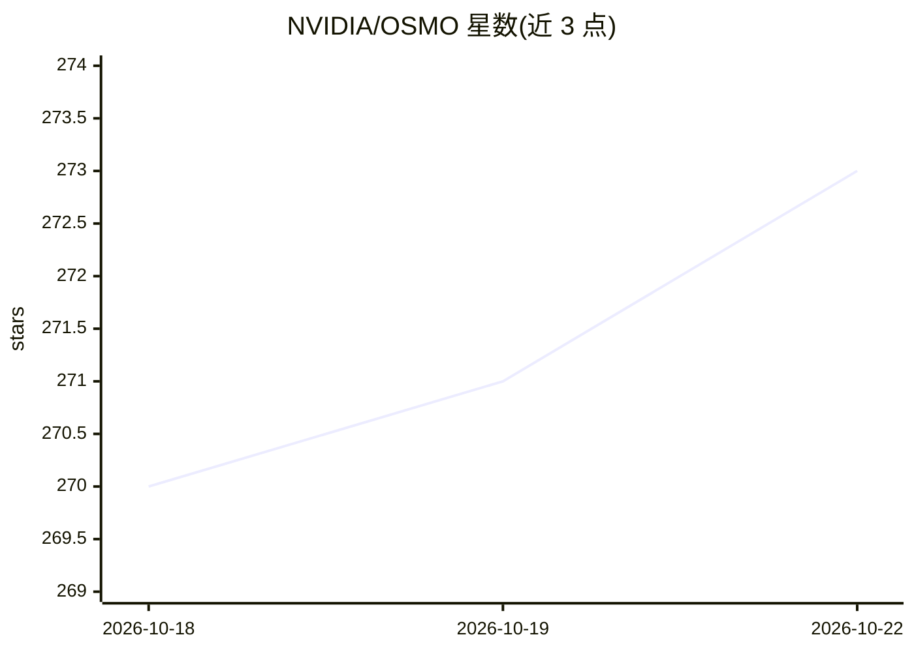

# NVIDIA/OSMO

⭐ 273 · Python · Apache-2.0 · 推送 2026-10-20 · [GitHub](https://github.com/NVIDIA/OSMO) · [官网](https://nvidia.github.io/OSMO) · 组织维护

**面向 Physical AI 的跨异构计算工作流编排平台**

NVIDIA 开源的 Physical AI 工作流编排平台：以 YAML 声明工作流，在本地 Docker/KIND 或云端 Kubernetes 集群上运行，统一编排训练 GPU、仿真集群与边缘设备三类算力。面向两类用户：机器人/AI 开发者可远程交互开发（VSCode/Jupyter/SSH）、生成合成数据（Isaac Sim）、分布式训练与 RL 策略训练、硬件在环测试；平台工程师可通过中央控制平面动态注册集群、跨云跨地域扩展算力。最初为支撑 Project GR00T、Isaac 系列内部工作负载开发。限制：依赖 Kubernetes 部署，Python 原生工作流与负载感知调度等能力列于 2026+ 路线图、尚未提供。

## 筛选速览

| 维度 | 判定 | 备注 |
|---|---|---|
| AI 角色 | `ai-ecosystem` | LLM/agent 周边工具 |
| 许可风险 | `permissive` | Apache-2.0 |
| 部署形态 | `None` |  |
| 模型依赖 | — | README 未给出锁定关系 |
| 硬件要求 | — | 无带数字的原话,不猜 |
| 安装摩擦 | `low` | 无编译、无系统依赖或容器化 |
| 成熟度 | — | 结构信号不足 |

## 能力要点

- YAML 声明式零代码工作流，同一工作流可在本地或云端运行
- 统一编排训练（GB200/H100）、仿真（L40/RTX Pro）与边缘（Jetson AGX Thor）三类算力
- 跨异构 Kubernetes 集群管理任务依赖与资源分配
- 支持远程交互开发（VSCode/Jupyter/SSH）与硬件在环测试

## 适用场景

- 跨云与本地集群运行机器人训练与仿真流水线
- 用合成数据生成和 RL 训练构建机器人开发数据工厂
- 平台团队统一管理多集群、多地域的 GPU 算力
- 在 CI/CD 中自动化 Physical AI 的训练-评测-测试流程

## 场景标签

`工作流自动化` · 领域:效率与自动化

## 证据(README 行号)

> L13: Use OSMO to manage your workflows and even remotely develop on a backend node. Using OSMO's backend configuration, 
> L53: OSMO solves this Three Computer Problem for robotics by orchestrating your entire Physical AI pipeline — from train

## 星数曲线

2026-10-18 270 → 2026-10-22 273（+3）

---
*卡片 v1 · prompt 1.4 · 生成 2026-10-22 · 置信度 high · 依据 README sha `8aa02bd33292` · [字段定义](../../DATASET.md)*
