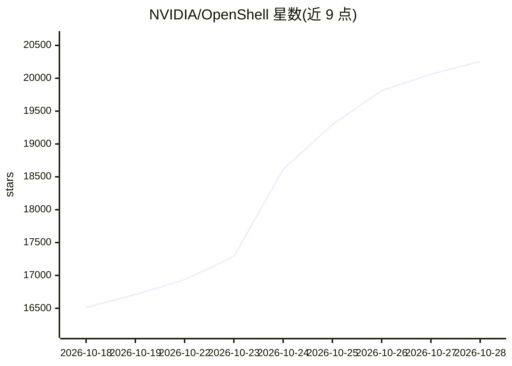

# NVIDIA/OpenShell

⭐ 20,255 · Rust · Apache-2.0 · 推送 2026-10-27 · [GitHub](https://github.com/NVIDIA/OpenShell) · [官网](https://docs.nvidia.com/openshell/latest/) · 组织维护

**为自主 AI agent 提供安全隔离运行时与策略管控**

面向多 agent 舰队（fleets of autonomous AI agents）的运行时：agent 需要读文件、装包、调 API、用凭证才有用，OpenShell 通过策略声明限定其可触达范围并在运行时强制执行。机制包括内核级隔离沙箱（文件、系统调用、网络逐一管控，真实凭证不暴露给 agent）与形式化验证（策略变更先标记高风险新增访问，等待人工审查）。提供 CLI 安装脚本、Python/TypeScript/Go/Rust SDK、agent skills 包及 Helm 部署网关。

## 筛选速览

| 维度 | 判定 | 备注 |
|---|---|---|
| AI 角色 | `ai-native` | 本体是模型或模型工具 |
| 许可风险 | `permissive` | Apache-2.0 |
| 部署形态 | `library` | 以包/库形式分发 |
| 模型依赖 | — | README 未给出锁定关系 |
| 硬件要求 | — | 无带数字的原话,不猜 |
| 安装摩擦 | `low` | 无编译、无系统依赖或容器化 |
| 成熟度 | — | 结构信号不足 |

## 动量与使用信号

- 维护:`active` — 距上次 push 1.3 天,年发版 100,132 位贡献者
- 涨星:近 1 天 **+124**(自 20261016 起算)
- 安装:npm 包 `@nvidia/openshell-sdk` 月下载无数据
- 平台:WINDOWS / MACOS / LINUX · 协议:—

## 能力要点

- 内核级沙箱强制执行文件/系统调用/网络策略
- 策略变更经形式化验证后进入人工审查
- 凭证仅注入发往已批准端点的请求
- 提供 Python/TypeScript/Go/Rust 四语言 SDK 与 Helm 部署

## 适用场景

- 运行能读写文件、调用 API 的自主 agent 但限制其权限
- 为 agent 使用的推理凭证做按端点的隔离注入
- 在 Kubernetes 上部署网关统一管理沙箱与策略

## 场景标签

`Agent 框架` · 领域:Agent 开发

## 证据(README 行号)

> L11: OpenShell is the safe, private runtime for fleets of autonomous AI agents. Agents are most useful when they can rea
> L15: OpenShell governs what agents can do in two ways: it instruments the kernel to enforce policy on every file access,
> L17: - **Kernel-level enforcement.** Each agent runs in an isolated sandbox. Kernel controls confine which files it can 

## 星数曲线

2026-10-18 16,511 → 2026-10-28 20,255（+3,744）

---
*卡片 v1 · prompt 1.4 · 生成 2026-10-18 · 置信度 high · 依据 README sha `fdaebf9b07a9` · [字段定义](../../DATASET.md)*
