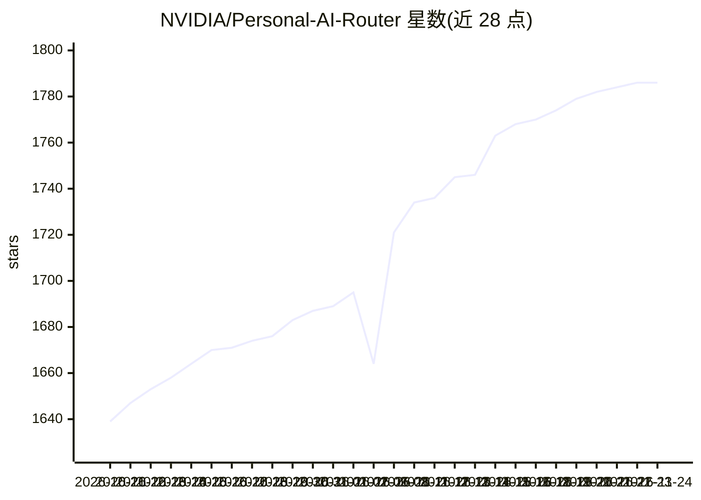

# NVIDIA/Personal-AI-Router

⭐ 1,787 · Go · Apache-2.0 · 推送 2026-11-23 · [GitHub](https://github.com/NVIDIA/Personal-AI-Router) · 组织维护

**家庭局域网内多机本地推理请求路由器**

NVIDIA Personal AI Router (PAIR) 是面向同一网络内多台兼容计算机的本地推理路由器：发现参与节点，管理受支持的推理引擎，提供 Ollama 兼容、OpenAI 兼容与 Anthropic Messages API 的本地代理端点，按引擎可用性、模型可用性与当前负载把独立请求路由到合适节点。适用于多智能体等并发本地负载；不合并 GPU 显存、不做模型分片。提供 Windows/Linux/macOS 安装包，也支持源码构建与终端界面。

## 筛选速览

| 维度 | 判定 | 备注 |
|---|---|---|
| AI 角色 | `ai-ecosystem` | LLM/agent 周边工具 |
| 许可风险 | `permissive` | Apache-2.0 |
| 部署形态 | `desktop` | 安装包/桌面程序 |
| 模型依赖 | local-ok | 支持本地模型 |
| 硬件要求 | — | 无带数字的原话,不猜 |
| 安装摩擦 | `low` | 无编译、无系统依赖或容器化 |
| 成熟度 | — | 结构信号不足 |

## 能力要点

- 提供 Ollama/OpenAI/Anthropic Messages API 兼容的本地代理端点
- 按引擎、模型可用性与负载将请求路由到局域网内节点
- 支持 Ollama、LM Studio、llama.cpp、vLLM 引擎的安装与管理
- 六位 PIN 配对组网，跨 Windows/Linux/macOS 混合节点

## 适用场景

- 把多台家用电脑组成本地推理集群供应用调用
- 多智能体应用的并发本地推理负载分发
- 无桌面环境的机器通过终端界面运行推理服务

## 场景标签

`模型网关` · 领域:Agent 开发

## 证据(README 行号)

> L7: local inference router for a group of compatible computers on the same network. It discovers participating nodes,
> L8: manages supported inference engines, and presents local proxy endpoints for
> L10: Independent requests can be routed to eligible nodes according to engine

## 星数曲线

2026-10-21 1,639 → 2026-11-24 1,786（+147）

---
*卡片 v1 · prompt 1.4 · 生成 2026-11-23 · 置信度 high · 依据 README sha `74d322996ac1` · [字段定义](../../DATASET.md)*
