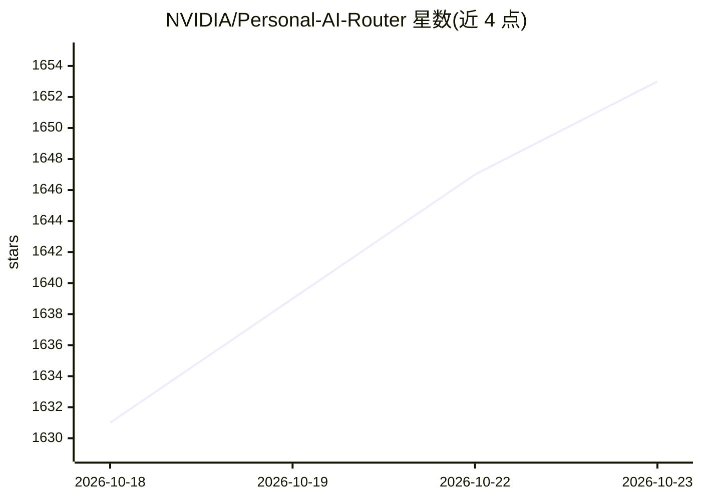

# NVIDIA/Personal-AI-Router

⭐ 1,653 · Go · Apache-2.0 · 推送 2026-10-20 · [GitHub](https://github.com/NVIDIA/Personal-AI-Router) · 组织维护

**家庭局域网多机本地推理路由器：跨设备分发请求**

NVIDIA Personal AI Router (PAIR) 是面向同一局域网内多台兼容电脑的本地推理路由器：发现参与节点、管理推理引擎（Ollama、LM Studio、llama.cpp），并提供 Ollama 兼容、OpenAI 兼容与 Anthropic Messages API 的本地代理端点；按引擎可用性、模型可用性与负载将独立请求路由到合适节点，适用于多 agent 并发场景。限制：不做 GPU 内存池化、不分片单模型、不拆分单次推理。提供 Windows/Linux/macOS 桌面安装包与终端界面。

## 筛选速览

| 维度 | 判定 | 备注 |
|---|---|---|
| AI 角色 | `ai-ecosystem` | LLM/agent 周边工具 |
| 许可风险 | `permissive` | Apache-2.0 |
| 部署形态 | `desktop` | 安装包/桌面程序 |
| 模型依赖 | local-ok | 支持本地模型 |
| 硬件要求 | — | 无带数字的原话,不猜 |
| 安装摩擦 | `low` | 无编译、无系统依赖或容器化 |
| 成熟度 | — | 结构信号不足 |

## 能力要点

- 跨 Windows/Linux/macOS 节点组网，按引擎/模型可用性与负载路由请求
- 提供 Ollama 兼容、OpenAI 兼容与 Anthropic Messages API 本地代理端点
- 内置安装与管理 Ollama、LM Studio、llama.cpp 推理引擎，可下载 GGUF 模型
- 提供签名安装包（exe/deb/dmg）、终端界面与 JSON-RPC API

## 适用场景

- 把家里多台电脑组成集群分担本地推理请求
- 多 agent 应用并发跑本地模型而不冲突
- 通过六位 PIN 配对第二台机器扩展算力节点

## 场景标签

`模型网关` `推理引擎` · 领域:Agent 开发

## 证据(README 行号)

> L7: local inference router for a group of compatible computers on the same network. It discovers participating nodes,
> L8: manages supported inference engines, and presents local proxy endpoints for
> L9: Ollama-compatible, OpenAI-compatible, and Anthropic Messages API requests.

## 星数曲线

2026-10-18 1,631 → 2026-10-23 1,653（+22）

---
*卡片 v1 · prompt 1.4 · 生成 2026-10-21 · 置信度 high · 依据 README sha `a3ec76f0a648` · [字段定义](../../DATASET.md)*
