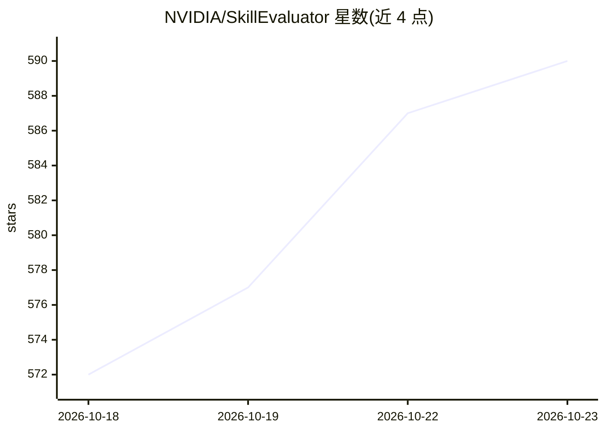

# NVIDIA/SkillEvaluator

⭐ 590 · Python · Apache-2.0 · 推送 2026-10-22 · [GitHub](https://github.com/NVIDIA/SkillEvaluator) · [官网](https://docs.nvidia.com/skills/skillevaluator/) · 组织维护

**面向开发者的 AI agent 技能评测框架：三层流水线+质量门**

NVIDIA 开源的多层评测框架，针对 Agent Skills 规范的技能产物（含 SKILL.md 的目录）：Tier 1 做确定性校验与安全扫描（Semgrep/SkillSpector/Gitleaks，LLM 检查需配置 provider），Tier 2 做技能内及跨技能目录的语义重叠检测（需 embeddings），Tier 3 在 Docker 沙箱中以配对有无技能实验（Skill Lift）评测技能对 agent 行为的影响，并生成合成评测数据集。它是 NVIDIA Verified Skills 流水线的组成部分。CLI 经 uv 从 GitHub 源安装，Tier 3 需 provider 访问与支持的 agent 运行时，实时调用可能产生费用。

## 筛选速览

| 维度 | 判定 | 备注 |
|---|---|---|
| AI 角色 | `ai-ecosystem` | LLM/agent 周边工具 |
| 许可风险 | `permissive` | Apache-2.0 |
| 部署形态 | `None` |  |
| 模型依赖 | locked-api |  |
| 硬件要求 | — | 无带数字的原话,不猜 |
| 安装摩擦 | `low` | 无编译、无系统依赖或容器化 |
| 成熟度 | — | 结构信号不足 |

## 能力要点

- Tier 1/2/3 可独立或组合运行（validate 自动驾驶模式）
- Tier 3 配对有无技能实验（Skill Lift），基于论文方法
- Tier 3 在 Docker 沙箱运行 provider 原生 agent，安全隔离
- 支持 NVIDIA Build/OpenAI/Anthropic/openai-compatible 网关

## 适用场景

- 发布前校验自研 agent 技能的安全性与结构合规
- 检测技能库内重复或重叠的指导内容
- 量化技能对 agent 行为的实际增益
- 生成合成评测数据集

## 场景标签

`模型评测` `网络安全` · 领域:评测与运维

## 证据(README 行号)

> L13: SkillEvaluator is an open-source, multi-tier framework for evaluating AI agent
> L41: SkillSpector provides Tier 1 security
> L90: - **Tier 3** creates one starter evaluation case if no dataset or task source

## 星数曲线

2026-10-18 572 → 2026-10-23 590（+18）

---
*卡片 v1 · prompt 1.4 · 生成 2026-10-21 · 置信度 high · 依据 README sha `9147ed7062e4` · [字段定义](../../DATASET.md)*
