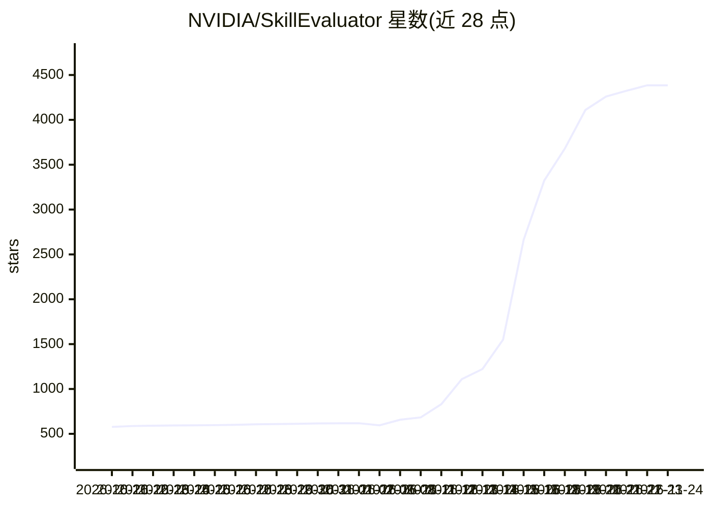

# NVIDIA/SkillEvaluator

⭐ 4,385 · Python · Apache-2.0 · 推送 2026-11-22 · [GitHub](https://github.com/NVIDIA/SkillEvaluator) · [官网](https://docs.nvidia.com/skills/skillevaluator/) · 组织维护

**给 AI agent 技能与插件做质量/安全/效果评测的 CLI 框架**

NVIDIA 出品的评测框架，按三层流水线检查 agent 技能：Tier 1 静态验证（500+ 规则，覆盖质量、schema、PII、许可、安全扫描，接入 SkillSpector/Gitleaks/Bandit/Semgrep/pip-audit）与 harness 兼容性检查；Tier 2 用嵌入与聊天做语义去重/重叠检测；Tier 3 在 Docker 沙箱中用 Harbor 运行真实 agent，对比有/无技能的任务结果以度量技能增益。Tier 1 无需 API key；全层需 NVIDIA Build 密钥。提供 GitHub/GitLab 可复用 CI 模板。

## 筛选速览

| 维度 | 判定 | 备注 |
|---|---|---|
| AI 角色 | `ai-ecosystem` | LLM/agent 周边工具 |
| 许可风险 | `permissive` | Apache-2.0 |
| 部署形态 | `self-host` | docker 或自建部署 |
| 模型依赖 | — | README 未给出锁定关系 |
| 硬件要求 | — | 无带数字的原话,不猜 |
| 安装摩擦 | `low` | 无编译、无系统依赖或容器化 |
| 成熟度 | — | 结构信号不足 |

## 能力要点

- 三层流水线：静态验证、语义去重、live agent 效果评测（skill lift）
- 500+ 静态规则与检测模式，Tier 1 无需 API key/GPU/Docker
- Harness Check 判定技能能否被 claude-code、codex 等 agent 加载
- GitHub/GitLab 可复用 CI 模板与 skillevaluator ci init 一键接入

## 适用场景

- 合并技能 PR 前用 CI 质量门禁拦截质量与安全问题
- 检测多个技能文件之间的重复或重叠指引
- 上线前用真实 agent 运行验证技能是否带来任务提升

## 场景标签

`模型评测` `代码审查` · 领域:编码与开发

## 证据(README 行号)

> L17: SkillEvaluator checks AI agent skills and plugins, and measures a skill's effect
> L26: Agent Skills specification. SkillEvaluator is part of
> L207: |Tier 1: Validation|Is the skill safe, well-formed and harness-compatible?|`skillevaluator tier1 ./my-skill --no-l

## 星数曲线

2026-10-21 577 → 2026-11-24 4,385（+3,808）

---
*卡片 v1 · prompt 1.4 · 生成 2026-11-22 · 置信度 mid · 依据 README sha `3b30fe7a4ace` · [字段定义](../../DATASET.md)*
