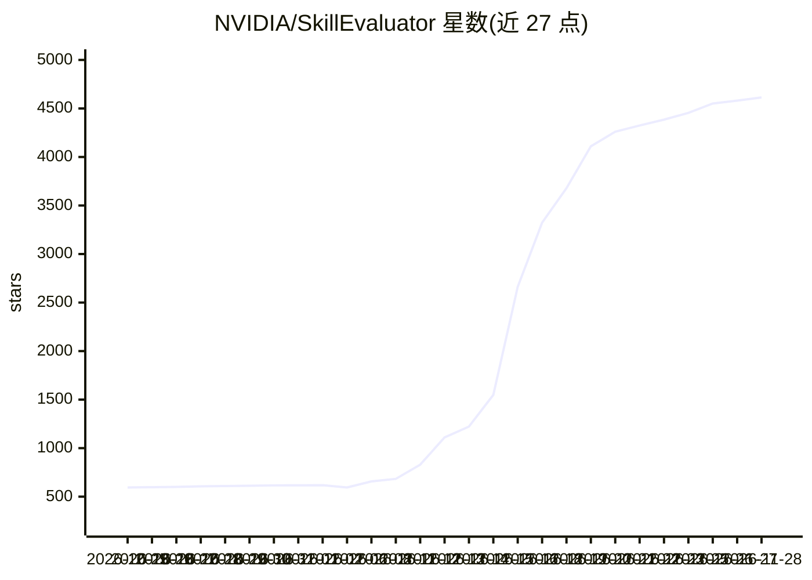

# NVIDIA/SkillEvaluator

⭐ 4,614 · Python · Apache-2.0 · 推送 2026-11-26 · [GitHub](https://github.com/NVIDIA/SkillEvaluator) · [官网](https://docs.nvidia.com/skills/skillevaluator/) · 组织维护

**评测 AI agent 技能/插件质量的 CLI 与 CI 门禁框架**

面向编写 agent 技能与插件的开发者，提供三层评估管线：Tier 1 静态校验（500+ 规则覆盖质量、schema、PII、许可证、安全扫描与 harness 兼容性检查，无需 LLM key）；Tier 2 基于嵌入的语义重复检测；Tier 3 通过沙箱中的真实 agent 运行衡量技能对任务结果的影响（skill lift）。以 Python CLI（PyPI/uv）发布，提供 GitHub/GitLab 可复用 CI 模板，并属 NVIDIA Verified Skills 管线的一部分。全量运行需 NVIDIA Build key、外部扫描器与 Docker。

## 筛选速览

| 维度 | 判定 | 备注 |
|---|---|---|
| AI 角色 | `ai-ecosystem` | LLM/agent 周边工具 |
| 许可风险 | `permissive` | Apache-2.0 |
| 部署形态 | `self-host` | docker 或自建部署 |
| 模型依赖 | — | README 未给出锁定关系 |
| 硬件要求 | — | 无带数字的原话,不猜 |
| 安装摩擦 | `low` | 无编译、无系统依赖或容器化 |
| 成熟度 | — | 结构信号不足 |

## 能力要点

- 三层评估：静态校验、语义去重、live agent 影响评测
- Tier 1 质量检查无需 API key、GPU 或 Docker，输出 100 分制评分
- harness-check 判定技能能否被 Claude Code/Codex 等 agent 正确加载
- GitHub/GitLab CI 模板与 skillevaluator ci init 一键接入

## 适用场景

- 技能合并前在 CI 中拦截质量与安全问题
- 检测多个技能间的语义重复与重叠
- 用带/不带技能的对照运行衡量技能实际收益

## 场景标签

`模型评测` · 领域:评测与运维

## 证据(README 行号)

> L17: SkillEvaluator checks AI agent skills and plugins, and measures a skill's effect
> L26: Agent Skills specification. SkillEvaluator is part of
> L207: |Tier 1: Validation|Is the skill safe, well-formed and harness-compatible?|`skillevaluator tier1 ./my-skill --no-l
> L210: |Tier 3: Live Agent Evaluation|Does the skill help the agent?|`skillevaluator tier3 ./my-skill`|Provider access, a

## 星数曲线

2026-10-25 595 → 2026-11-28 4,614（+4,019）

---
*卡片 v1 · prompt 1.4 · 生成 2026-11-26 · 置信度 mid · 依据 README sha `0f2220d650bf` · [字段定义](../../DATASET.md)*
