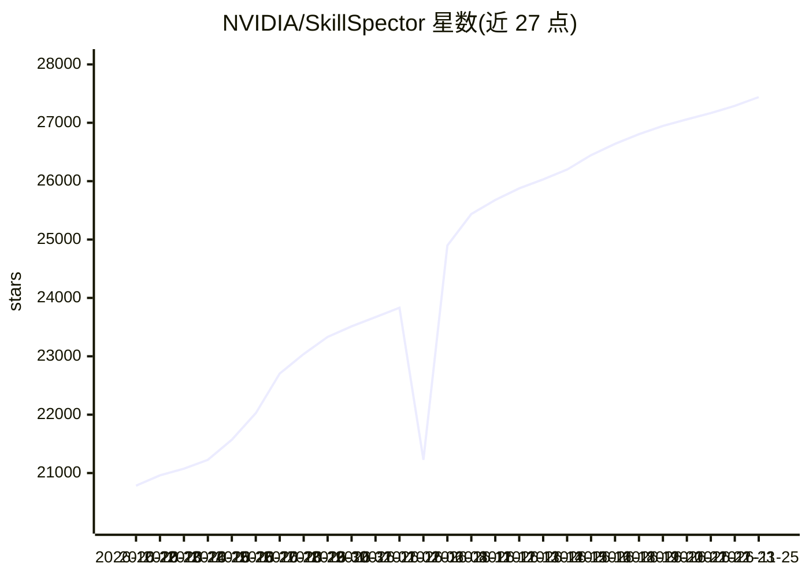

# NVIDIA/SkillSpector

⭐ 27,440 · Python · Apache-2.0 · 推送 2026-11-22 · [GitHub](https://github.com/NVIDIA/SkillSpector) · [官网](https://docs.nvidia.com/skills/scanning-agent-skills) · 组织维护

**面向开发者的 AI agent 技能安装前安全扫描器**

NVIDIA 出品的 agent 技能安全扫描工具：在安装前对 Claude Code、Codex、Gemini CLI 等使用的 agent 技能做静态与可选 LLM 语义分析，检测提示注入、数据外泄、供应链、提权、MCP 工具投毒等 17 类共 71 种漏洞模式，输出 0-100 风险评分与终端/JSON/Markdown/SARIF 报告。支持扫描 Git 仓库、URL、zip、目录及 MCP registry 快照对比，提供基线误报抑制与递归/批量扫描，多语言检测覆盖中日韩。依赖 Python 3.12/3.13 以获得预编译 YARA 轮子，否则需本地源码编译。

## 筛选速览

| 维度 | 判定 | 备注 |
|---|---|---|
| AI 角色 | `ai-ecosystem` | LLM/agent 周边工具 |
| 许可风险 | `permissive` | Apache-2.0 |
| 部署形态 | `self-host` | docker 或自建部署 |
| 模型依赖 | — | README 未给出锁定关系 |
| 硬件要求 | — | 无带数字的原话,不猜 |
| 安装摩擦 | `low` | 无编译、无系统依赖或容器化 |
| 成熟度 | — | 结构信号不足 |

## 动量与使用信号

- 维护:`active` — 距上次 push 0.9 天,年发版 18,102 位贡献者
- 涨星:近 1 天 **+88**(自 20261016 起算)
- 平台:— · 协议:OPENAI-API / MCP / OLLAMA

## 能力要点

- 71 种漏洞模式检测，覆盖提示注入、数据外泄、供应链与 MCP 工具投毒等 17 类
- 两阶段分析：静态扫描 + 可选 LLM 语义评估，SC4 实时查询 OSV.dev CVE 数据
- 支持 Git/URL/zip/目录/单文件多格式输入与 SARIF/JSON/Markdown 报告输出
- MCP registry 快照对比与批量并行扫描，支持 CI fail-on-incomplete

## 适用场景

- 安装社区 agent 技能前检查是否存在恶意模式或提示注入
- CI 流水线中批量扫描技能集合并拦截不完整覆盖
- 对比 MCP registry 前后快照，审查服务器版本变更带来的风险

## 场景标签

`网络安全` · 领域:学习与行业

## 证据(README 行号)

> L3: **Security scanner for AI agent skills.** Detect vulnerabilities, malicious patterns, and security risks before inst
> L14: SkillSpector is part of the NVIDIA Verified Skills pipeline, which scans, evaluates, and signs agent skills before 
> L34: - **Two-stage analysis**: Fast static analysis + optional LLM semantic evaluation

## 星数曲线

2026-10-22 20,783 → 2026-11-25 27,440（+6,657）

---
*卡片 v1 · prompt 1.4 · 生成 2026-11-23 · 置信度 mid · 依据 README sha `7c6b514476aa` · [字段定义](../../DATASET.md)*
