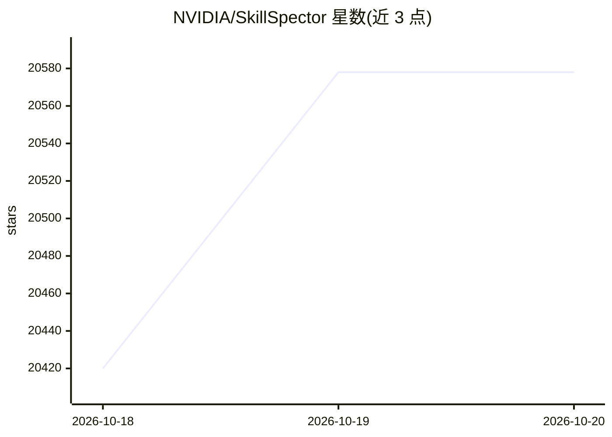

# NVIDIA/SkillSpector

⭐ 20,578 · Python · Apache-2.0 · 推送 2026-10-19 · [GitHub](https://github.com/NVIDIA/SkillSpector) · [官网](https://docs.nvidia.com/skills/scanning-agent-skills) · 组织维护

**给安装 AI agent 技能前的用户做安全扫描的命令行工具**

SkillSpector 是面向 AI agent 技能（SKILL.md、MCP 等）的安全扫描器，在安装前检测漏洞模式、恶意行为、提示注入、数据外泄与供应链风险。提供 71 种检测模式、两阶段分析（静态分析 + 可选 LLM 语义评估）、0-100 风险评分、基线误报抑制、多格式输入与输出报告，支持 Docker 运行与批量扫描，并可作为 Pi/OpenCode 扩展嵌入 agent 会话。它是 NVIDIA Verified Skills 流水线的组成部分。LLM 语义分析需配置 OpenAI 兼容端点；对超大输入设有 fail-closed 上限。

## 筛选速览

| 维度 | 判定 | 备注 |
|---|---|---|
| AI 角色 | `ai-ecosystem` | LLM/agent 周边工具 |
| 许可风险 | `permissive` | Apache-2.0 |
| 部署形态 | `self-host` | docker 或自建部署 |
| 模型依赖 | local-ok | 支持本地模型 |
| 硬件要求 | — | 无带数字的原话,不猜 |
| 安装摩擦 | `low` | 无编译、无系统依赖或容器化 |
| 成熟度 | — | 结构信号不足 |

## 动量与使用信号

- 维护:`active` — 距上次 push 0.9 天,年发版 18,102 位贡献者
- 涨星:近 1 天 **+88**(自 20261016 起算)
- 平台:— · 协议:OPENAI-API / MCP / OLLAMA

## 能力要点

- 71 种漏洞模式，覆盖提示注入、数据外泄、供应链、MCP 工具投毒等 17 类
- 静态分析 + 可选 LLM 语义评估的两阶段扫描
- 支持 openai/anthropic/bedrock/gemini/ollama/vllm 等多种 SKILLSPECTOR_PROVIDER
- 基线机制抑制已知误报，重复扫描只暴露新问题

## 适用场景

- 安装 Claude Code / Codex / MCP 技能前检测恶意模式与提示注入
- CI 中批量扫描技能目录并按 JSON/SARIF 报告做门禁
- 对比 MCP Registry 快照，发现服务器身份与字段变化

## 场景标签

`网络安全` · 领域:学习与行业

## 证据(README 行号)

> L3: **Security scanner for AI agent skills.** Detect vulnerabilities, malicious patterns, and security risks before inst
> L14: SkillSpector is part of the NVIDIA Verified Skills pipeline, which scans, evaluates, and signs agent skills before 
> L26: - **Multi-format input**: Scan Git repos, URLs, zip files, directories, or single files
> L260: |Provider (`SKILLSPECTOR_PROVIDER`)|Credential env var|Endpoint|Default model|

## 星数曲线

2026-10-18 20,420 → 2026-10-20 20,578（+158）

---
*卡片 v1 · prompt 1.4 · 生成 2026-10-18 · 置信度 mid · 依据 README sha `747786e000f0` · [字段定义](../../DATASET.md)*
