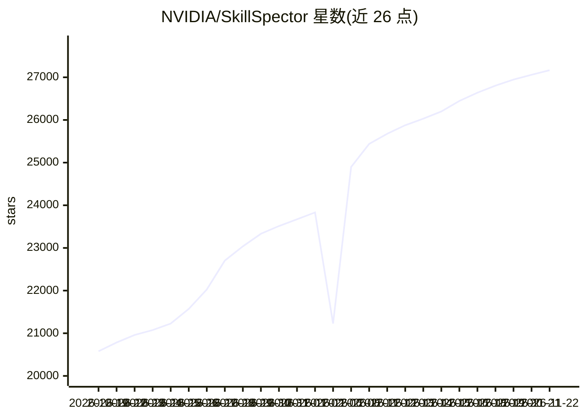

# NVIDIA/SkillSpector

⭐ 27,166 · Python · Apache-2.0 · 推送 2026-11-20 · [GitHub](https://github.com/NVIDIA/SkillSpector) · [官网](https://docs.nvidia.com/skills/scanning-agent-skills) · 组织维护

**AI agent 技能安装前的安全扫描器**

面向 AI agent 技能（SKILL.md 等）的安装前安全扫描工具：支持扫描 Git 仓库、URL、zip、目录或单文件，内置 71 种漏洞模式（17 类），覆盖提示注入、数据外泄、供应链、MCP 最小权限与工具投毒等；采用静态分析加可选 LLM 语义评估的两阶段流程，输出 0-100 风险分与 SARIF/JSON/Markdown 报告，并支持 OSV.dev 实时 CVE 查询、基线抑制、批量递归扫描与 MCP 注册表快照对比。目标用户是需要在安装 agent 技能前评估其安全性的开发者与团队。

## 筛选速览

| 维度 | 判定 | 备注 |
|---|---|---|
| AI 角色 | `ai-ecosystem` | LLM/agent 周边工具 |
| 许可风险 | `permissive` | Apache-2.0 |
| 部署形态 | `self-host` | docker 或自建部署 |
| 模型依赖 | — | README 未给出锁定关系 |
| 硬件要求 | — | 无带数字的原话,不猜 |
| 安装摩擦 | `low` | 无编译、无系统依赖或容器化 |
| 成熟度 | — | 结构信号不足 |

## 动量与使用信号

- 维护:`active` — 距上次 push 0.9 天,年发版 18,102 位贡献者
- 涨星:近 1 天 **+88**(自 20261016 起算)
- 平台:— · 协议:OPENAI-API / MCP / OLLAMA

## 能力要点

- 71 种漏洞模式 / 17 类，含 MCP 最小权限（LP1–LP4）与工具投毒（TP1–TP4）检测
- 静态分析 + 可选 LLM 语义评估的两阶段扫描，支持多 API key 池提升并发
- 多格式输入（Git/URL/zip/目录/文件）与 Terminal/JSON/Markdown/SARIF 报告输出
- 支持 OSV.dev 实时漏洞查询（SC4）、基线误报抑制与注册表快照对比

## 适用场景

- 在安装 Claude Code / Codex / MCP 技能前扫描是否存在恶意模式
- 在 CI 中用 --fail-on-incomplete 门禁技能安装流程
- 批量扫描技能集合并生成 JSON/SARIF 报告供安全审计
- 对比 MCP Registry 前后快照，监控服务端配置变化

## 场景标签

`网络安全` · 领域:学习与行业

## 证据(README 行号)

> L3: **Security scanner for AI agent skills.** Detect vulnerabilities, malicious patterns, and security risks before inst
> L14: SkillSpector is part of the NVIDIA Verified Skills pipeline, which scans, evaluates, and signs agent skills before 
> L33: - **71 vulnerability patterns** across 17 categories: prompt injection, data exfiltration, privilege escalation, su

## 星数曲线

2026-10-19 20,578 → 2026-11-22 27,166（+6,588）

---
*卡片 v1 · prompt 1.4 · 生成 2026-11-22 · 置信度 mid · 依据 README sha `0adf97f4cd81` · [字段定义](../../DATASET.md)*
