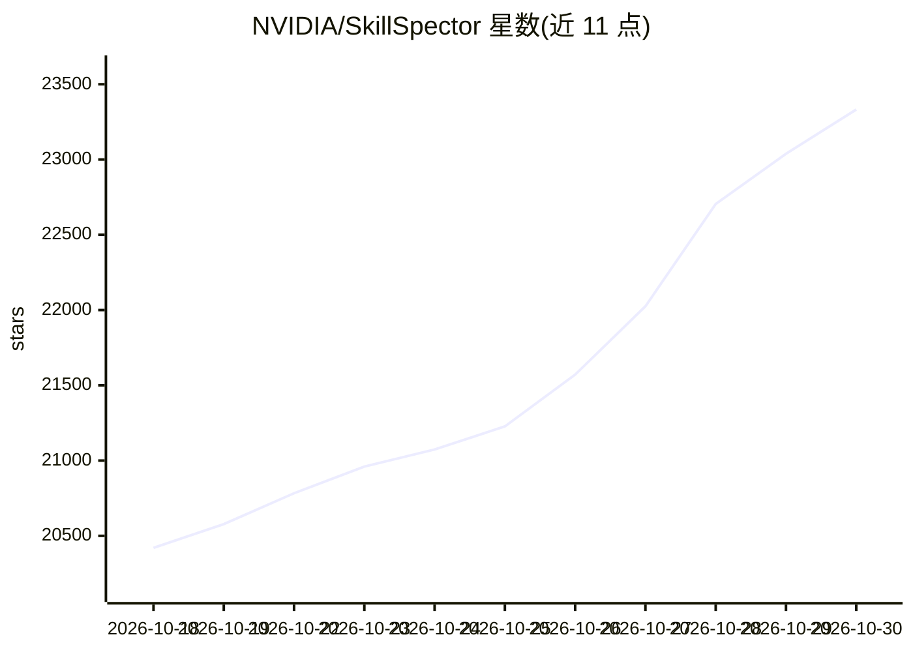

# NVIDIA/SkillSpector

⭐ 23,332 · Python · Apache-2.0 · 推送 2026-10-29 · [GitHub](https://github.com/NVIDIA/SkillSpector) · [官网](https://docs.nvidia.com/skills/scanning-agent-skills) · 组织维护

**AI agent 技能安装前安全扫描器：检测漏洞与恶意模式**

NVIDIA 维护的 agent 技能安全扫描工具：在安装 Claude Code、Codex 等 agent 技能前，对 Git 仓库、URL、zip、目录等输入做静态分析，覆盖 17 类共 71 种漏洞模式（提示注入、数据外泄、供应链、MCP 工具投毒等），可选接入 OpenAI 兼容 LLM 端点做语义评估，输出 0-100 风险评分与 Terminal/JSON/Markdown/SARIF 报告。支持基线误报抑制、MCP 注册表快照对比与并行批量扫描。研究数据集中 26.1% 技能含漏洞、5.2% 疑似恶意。需 Python 3.12+，也可用 Docker 运行。

## 筛选速览

| 维度 | 判定 | 备注 |
|---|---|---|
| AI 角色 | `ai-ecosystem` | LLM/agent 周边工具 |
| 许可风险 | `permissive` | Apache-2.0 |
| 部署形态 | `self-host` | docker 或自建部署 |
| 模型依赖 | local-ok | 支持本地模型 |
| 硬件要求 | — | 无带数字的原话,不猜 |
| 安装摩擦 | `low` | 无编译、无系统依赖或容器化 |
| 成熟度 | — | 结构信号不足 |

## 动量与使用信号

- 维护:`active` — 距上次 push 0.9 天,年发版 18,102 位贡献者
- 涨星:近 1 天 **+88**(自 20261016 起算)
- 平台:— · 协议:OPENAI-API / MCP / OLLAMA

## 能力要点

- 71 种漏洞模式覆盖 17 类（提示注入、数据外泄、供应链、MCP 投毒等）
- 两阶段分析：快速静态分析 + 可选 LLM 语义评估，支持多种 OpenAI 兼容提供商
- 0-100 风险评分与多格式报告（Terminal/JSON/Markdown/SARIF）
- 基线误报抑制、MCP 注册表快照对比、多 worker 批量扫描

## 适用场景

- 安装第三方 agent 技能前检查是否含恶意代码或提示注入
- 批量扫描技能目录并输出 JSON 报告用于 CI 门禁
- 对比 MCP 注册表快照发现服务器条目变更

## 场景标签

`网络安全` · 领域:学习与行业

## 证据(README 行号)

> L3: **Security scanner for AI agent skills.** Detect vulnerabilities, malicious patterns, and security risks before inst
> L27: - **71 vulnerability patterns** across 17 categories: prompt injection, data exfiltration, privilege escalation, su
> L29: - **Live vulnerability lookups**: SC4 queries OSV.dev for real-time CVE data with automatic offline fallback

## 星数曲线

2026-10-18 20,420 → 2026-10-30 23,332（+2,912）

---
*卡片 v1 · prompt 1.4 · 生成 2026-10-20 · 置信度 mid · 依据 README sha `41fe58617a13` · [字段定义](../../DATASET.md)*
