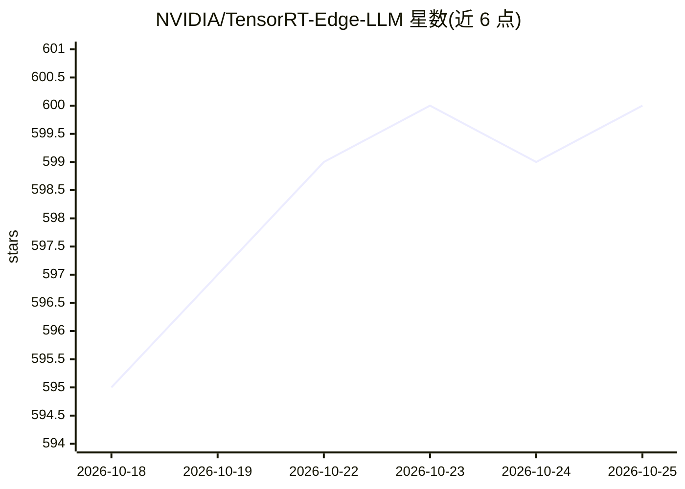

# NVIDIA/TensorRT-Edge-LLM

⭐ 600 · Python · Apache-2.0 · 推送 2026-10-24 · [GitHub](https://github.com/NVIDIA/TensorRT-Edge-LLM) · 组织维护

**面向 NVIDIA 边缘平台的 C++ LLM/VLM 推理运行时**

NVIDIA 维护的 C++ 推理软件，在 Jetson、DRIVE、DGX Spark 等边缘平台上运行文本、视觉、音频、语音与动作模型。前端将 Hugging Face 检查点导出为 ONNX 供 C++ 引擎构建，另有实验性路径跳过 ONNX 直接从检查点构建引擎；两条路径共用同一 C++ 部署运行时。提供 Python wheel 安装（需受支持的 CUDA/TensorRT 栈）、vLLM 风格 Python API 与实验性 OpenAI 兼容服务器，支持量化与投机解码。用例覆盖车载助手、机器人、工业物联网与边缘设备。

## 筛选速览

| 维度 | 判定 | 备注 |
|---|---|---|
| AI 角色 | `ai-ecosystem` | LLM/agent 周边工具 |
| 许可风险 | `permissive` | Apache-2.0 |
| 部署形态 | `library` | 以包/库形式分发 |
| 模型依赖 | — | README 未给出锁定关系 |
| 硬件要求 | — | 无带数字的原话,不猜 |
| 安装摩擦 | `medium` | 含编译或系统依赖之一 |
| 成熟度 | `idea` | |

## 能力要点

- C++ 部署运行时，支持 ONNX 导出与直接构建两条引擎路径
- 通过 pip 安装已发布 wheel，无需编译（需 CUDA/TensorRT 栈）
- 提供 vLLM 风格 Python API 与实验性 OpenAI 兼容服务器
- 支持量化检查点与投机解码（EAGLE、DFlash 等）

## 适用场景

- 在 Jetson/DRIVE/DGX Spark 上部署 LLM/VLM 推理
- 车载 AI 助手与语音交互界面开发
- 机器人自然语言交互与视觉问答
- 边缘设备离线低延迟语言处理

## 场景标签

`推理引擎` · 领域:训练与推理

## 证据(README 行号)

> L22: TensorRT Edge-LLM is NVIDIA's C++ inference runtime for text, vision, audio, speech, and action models on NVIDIA Je
> L28: For a supported target, install a published Python wheel

## 星数曲线

2026-10-18 595 → 2026-10-25 600（+5）

---
*卡片 v1 · prompt 1.4 · 生成 2026-10-21 · 置信度 high · 依据 README sha `acbd43d0f84b` · [字段定义](../../DATASET.md)*
