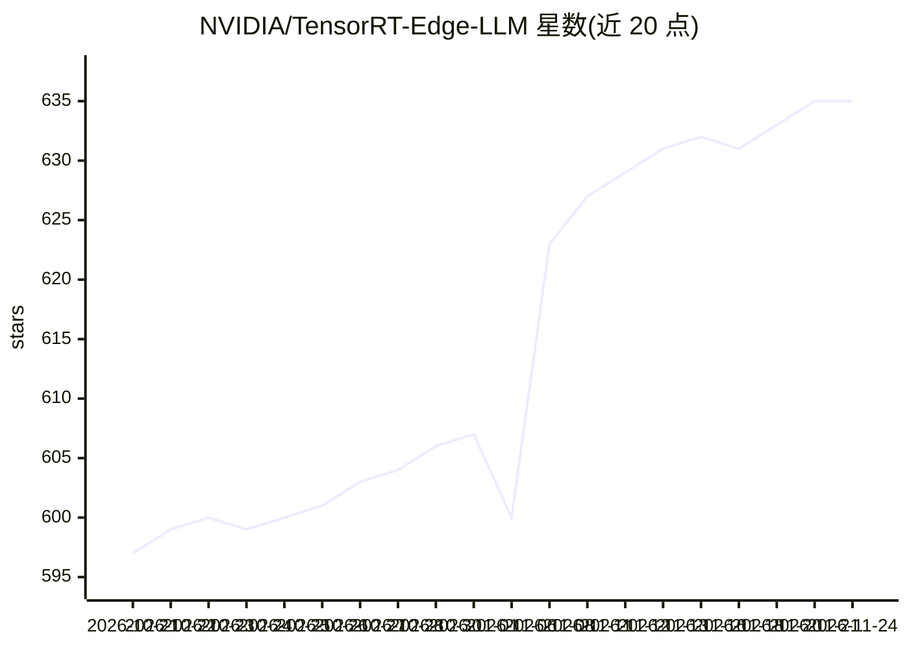

# NVIDIA/TensorRT-Edge-LLM

⭐ 635 · Python · Apache-2.0 · 推送 2026-11-17 · [GitHub](https://github.com/NVIDIA/TensorRT-Edge-LLM) · 组织维护

**NVIDIA 边缘平台上的 C++ LLM/VLM 推理运行时**

NVIDIA 发布的 C++ 推理运行时，面向 Jetson、DRIVE、DGX Spark 平台运行文本、视觉、语音及动作模型。前端将 Hugging Face 检查点导出为 ONNX 构建 C++ 引擎，另有实验性免 ONNX 的直接构建路径；两条路径共用同一部署运行时。提供 Python wheel 与 trtedge CLI（聊天、服务、引擎构建、ONNX 导出），支持量化、EAGLE/DFlash 投机解码、多轮 KV-cache 复用，并附带 OpenAI 兼容的实验性服务器与供编码 agent 使用的技能目录。需受支持的 CUDA/TensorRT 软件栈。

## 筛选速览

| 维度 | 判定 | 备注 |
|---|---|---|
| AI 角色 | `ai-ecosystem` | LLM/agent 周边工具 |
| 许可风险 | `permissive` | Apache-2.0 |
| 部署形态 | `library` | 以包/库形式分发 |
| 模型依赖 | — | README 未给出锁定关系 |
| 硬件要求 | — | 无带数字的原话,不猜 |
| 安装摩擦 | `medium` | 含编译或系统依赖之一 |
| 成熟度 | — | 结构信号不足 |

## 能力要点

- 支持 ONNX 导出与实验性直接引擎构建两条前端路径
- 提供 trtedge CLI：聊天、服务模型、构建引擎、导出 ONNX
- 支持量化检查点、投机解码与多轮 KV-cache 复用
- skills/ 目录供 Codex、Cursor、Claude Code 等 agent 主机发现使用

## 适用场景

- 在 Jetson/DRIVE/DGX Spark 上部署和运行 LLM/VLM 推理
- 车载助手、机器人、工业 IoT 等边缘设备上的本地推理
- 通过 OpenAI 兼容服务器提供边缘推理服务

## 场景标签

`多模态` `模型量化` `推理引擎` · 领域:感知与多模态

## 证据(README 行号)

> L24: TensorRT Edge-LLM is NVIDIA's C++ inference runtime for text, vision, audio, speech, and action models on NVIDIA Je
> L91: - **Python API and OpenAI-Compatible Server** - vLLM-style API and OpenAI-compatible server

## 星数曲线

2026-10-21 597 → 2026-11-24 635（+38）

---
*卡片 v1 · prompt 1.4 · 生成 2026-11-24 · 置信度 high · 依据 README sha `9f7497ba65c3` · [字段定义](../../DATASET.md)*
