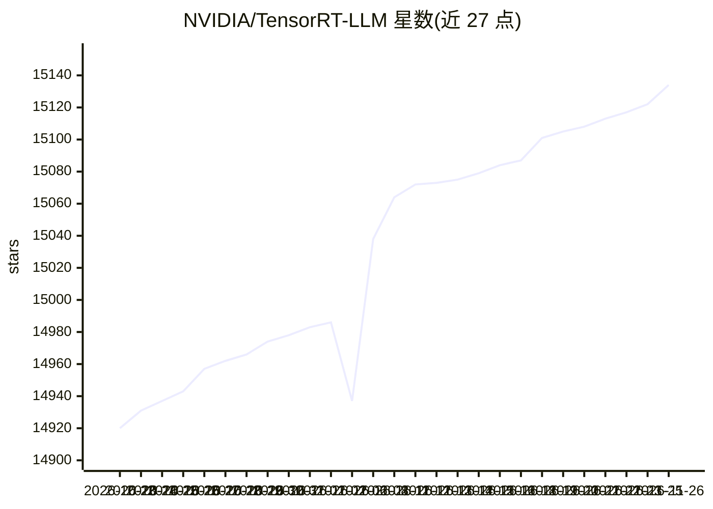

# NVIDIA/TensorRT-LLM

⭐ 15,134 · Python · NOASSERTION · 推送 2026-11-25 · [GitHub](https://github.com/NVIDIA/TensorRT-LLM) · [官网](https://nvidia.github.io/TensorRT-LLM) · 组织维护

**NVIDIA GPU 上优化 LLM 与视觉生成模型推理的开源库**

面向在 NVIDIA GPU 上部署大模型推理的开发者：以 PyTorch 为基础提供 Python LLM API，定义并运行 LLM 与视觉生成模型；内置针对 attention、GEMM、MoE 等常见操作的定制 kernel，以及 Prefill-Decode 分离、宽专家并行、投机解码等运行时优化；支持单卡到多卡、多节点部署，并提供 Python 与 C++ 运行时组件，可与 NVIDIA Dynamo、Triton Inference Server 等推理生态组件集成。支持范围限定于 NVIDIA GPU。

## 筛选速览

| 维度 | 判定 | 备注 |
|---|---|---|
| AI 角色 | `ai-ecosystem` | LLM/agent 周边工具 |
| 许可风险 | `none` | NOASSERTION |
| 部署形态 | `None` |  |
| 模型依赖 | — | README 未给出锁定关系 |
| 硬件要求 | — | 无带数字的原话,不猜 |
| 安装摩擦 | `medium` | 含编译或系统依赖之一 |
| 成熟度 | — | 结构信号不足 |

## 动量与使用信号

- 维护:`active` — 距上次 push 0.7 天,年发版 48,421 位贡献者
- 涨星:近 1 天 **+12**(自 20261016 起算)

## 能力要点

- 基于 PyTorch 的 Python LLM API，覆盖单 GPU 到多 GPU/多节点部署
- 针对 attention、GEMM、MoE 等操作的定制 kernel 与运行时优化（投机解码、Prefill-Decode 分离、宽 EP）
- 支持 LLM 与视觉生成模型（含扩散模型）推理
- 与 NVIDIA Dynamo、Triton Inference Server 集成

## 适用场景

- 在 NVIDIA GPU 上部署和运行 LLM 推理服务
- 为 DeepSeek、Llama 等开源模型做推理优化
- 搭建多 GPU/多节点的推理部署
- 运行视觉生成类模型的加速推理

## 场景标签

`推理引擎` · 领域:训练与推理

## 证据(README 行号)

> L2:  TensorRT LLM optimizes inference for LLMs and Visual Gen models with specialized kernels for common operations, an 
> L275: TensorRT LLM is an open-sourced library for optimizing LLM and Visual Gen inference. It provides state-of-the-art 
> L277: Architected on PyTorch, TensorRT LLM provides a high-level Python LLM API that supports a wide range of inference 

## 星数曲线

2026-10-23 14,920 → 2026-11-26 15,134（+214）

---
*卡片 v1 · prompt 1.4 · 生成 2026-11-26 · 置信度 high · 依据 README sha `5be4fd3e867d` · [字段定义](../../DATASET.md)*
