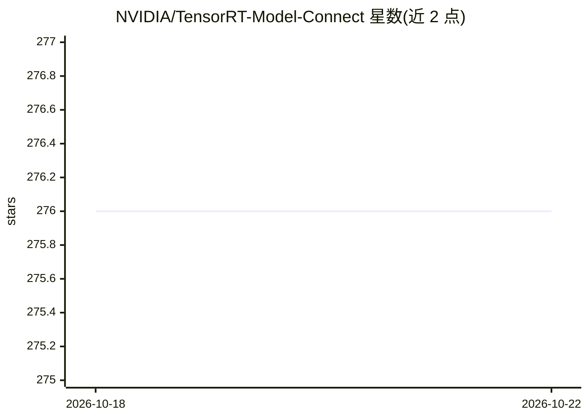

# NVIDIA/TensorRT-Model-Connect

⭐ 280 · Python · Apache-2.0 · 推送 2026-10-22 · [GitHub](https://github.com/NVIDIA/TensorRT-Model-Connect) · [官网](https://nvidia.github.io/TensorRT-Model-Connect/) · 组织维护

**将 HuggingFace 模型经 TensorRT 端到端部署的 C++ 参考实现集**

NVIDIA 维护的 TensorRT 之上的 AI 模型参考实现集合：从 Hugging Face 或本地 checkpoint 出发，用两条命令构建 TensorRT 引擎（无需中间 ONNX 导出），产出带版本的 .bundle 产物，同一 bundle 可供 Python 与 C++ 任务 API（文本生成、转录、图像/视频生成、分割、嵌入、预测）调用。由 agentic workflow 持续添加新模型支持。项目处于 Public Preview，自述为实验性、API 与范围可能变化，面向希望探索和评测广覆盖模型的开发者。

## 筛选速览

| 维度 | 判定 | 备注 |
|---|---|---|
| AI 角色 | `ai-ecosystem` | LLM/agent 周边工具 |
| 许可风险 | `permissive` | Apache-2.0 |
| 部署形态 | `None` |  |
| 模型依赖 | — | README 未给出锁定关系 |
| 硬件要求 | — | 无带数字的原话,不猜 |
| 安装摩擦 | `low` | 无编译、无系统依赖或容器化 |
| 成熟度 | `idea` | |

## 能力要点

- 两条命令完成 PyTorch→TensorRT 端到端推理，跳过 ONNX 导出步骤
- 同一 .bundle 产物供 Python-first 构建环境与原生 C++ 任务 API 共用
- 由 agentic workflow 持续添加新模型支持，降低用户侧集成工作量
- 提供模型族专属 builders、运行时流水线与验证契约作为定制蓝图

## 适用场景

- 在 NVIDIA GPU 上快速探索和评测 TensorRT 支持的 HF 模型
- 从 checkpoint 构建版本化 bundle 交给原生 C++ 应用调用
- 参考模型族实现定制自己的 TensorRT 集成

## 场景标签

`推理引擎` · 领域:训练与推理

## 证据(README 行号)

> L51: **TensorRT Model Connect is an extensive collection of AI Model reference implementations in C++, on top of NVIDIA 
> L74: - Keep native TensorRT and optional TensorRT-RTX execution behind the same

## 星数曲线

2026-10-18 276 → 2026-10-22 276（+0）

---
*卡片 v1 · prompt 1.4 · 生成 2026-10-22 · 置信度 high · 依据 README sha `d494d1d24e29` · [字段定义](../../DATASET.md)*
