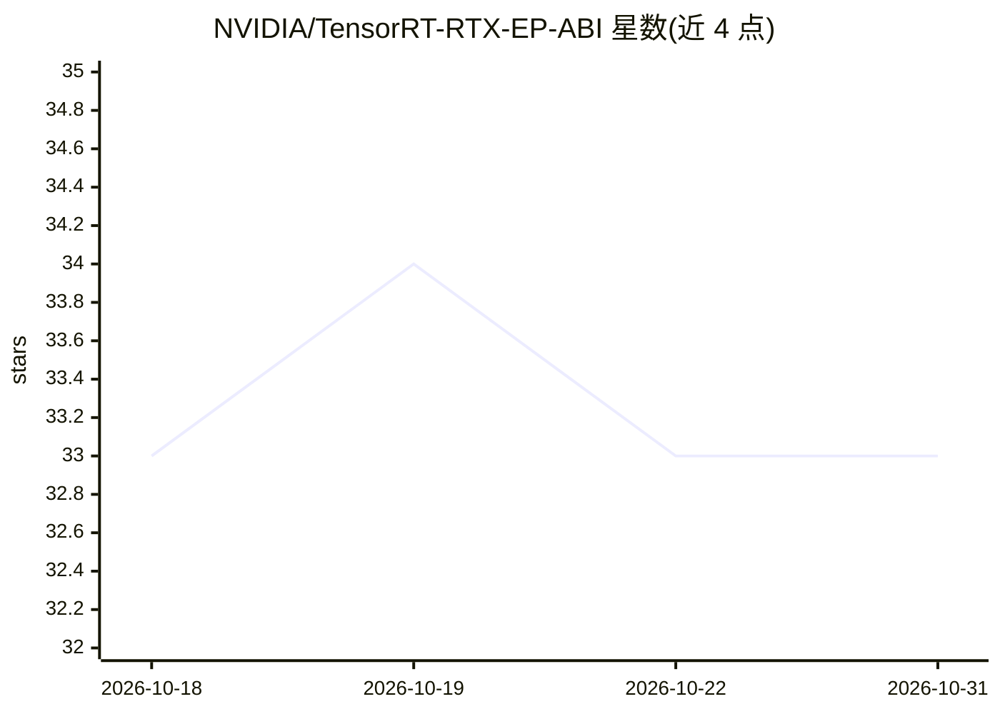

# NVIDIA/TensorRT-RTX-EP-ABI

⭐ 33 · C++ · Apache-2.0 · 推送 2026-10-21 · [GitHub](https://github.com/NVIDIA/TensorRT-RTX-EP-ABI) · [官网](https://nvidia.github.io/TensorRT-RTX-EP-ABI/) · 组织维护

**面向 NVIDIA RTX GPU 的 ONNX Runtime 推理执行提供器插件**

NVIDIA 维护的独立插件，实现 ORT Plugin EP ABI，通过 TensorRT for RTX 在 RTX GPU（Ampere 及之后）上加速 ONNX 模型推理，面向客户端场景部署。测试矩阵列出 EP 0.1–0.5 版本与 ONNX Runtime 版本兼容范围、对应 TRT RTX 版本，并记录 Weight Streaming、零拷贝、CUDA Graph、Windows-on-Arm 构建等特性。安装、源码构建、集成指南与 API 参考发布在外部文档站点。Apache 2.0 许可。

## 筛选速览

| 维度 | 判定 | 备注 |
|---|---|---|
| AI 角色 | `ai-ecosystem` | LLM/agent 周边工具 |
| 许可风险 | `permissive` | Apache-2.0 |
| 部署形态 | `None` |  |
| 模型依赖 | — | README 未给出锁定关系 |
| 硬件要求 | — | 无带数字的原话,不猜 |
| 安装摩擦 | `medium` | 含编译或系统依赖之一 |
| 成熟度 | — | 结构信号不足 |

## 能力要点

- 实现 ORT Plugin EP ABI 的独立插件，配合 ONNX Runtime 使用
- 针对 NVIDIA RTX GPU（Ampere 及之后）加速 ONNX 模型推理
- 支持 Weight Streaming、iGPU/独显零拷贝、CUDA Graph、Windows-on-Arm 构建
- 测试矩阵给出 EP 版本与 ORT/TRT RTX 版本兼容范围

## 适用场景

- 在配备 RTX GPU 的客户端设备上部署 ONNX 模型推理
- 为 ONNX Runtime 接入 TensorRT for RTX 加速后端
- 需要 Weight Streaming 与延迟/流式权重加载的低显存场景

## 场景标签

`推理引擎` · 领域:训练与推理

## 证据(README 行号)

> L7: The NVIDIA TensorRT RTX Execution Provider (EP) is an inference deployment solution designed
> L9: standalone plugin that implements the ORT Plugin EP ABI and leverages
> L10: TensorRT for RTX to accelerate ONNX models on

## 星数曲线

2026-10-18 33 → 2026-10-31 33（+0）

---
*卡片 v1 · prompt 1.4 · 生成 2026-10-25 · 置信度 high · 依据 README sha `423cfbb0468b` · [字段定义](../../DATASET.md)*
