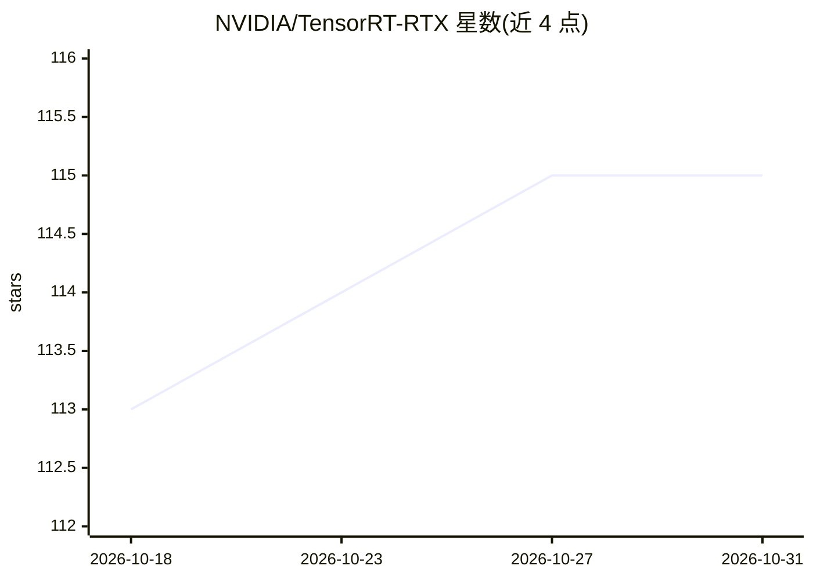

# NVIDIA/TensorRT-RTX

⭐ 115 · Apache-2.0 · 推送 2026-10-15 · [GitHub](https://github.com/NVIDIA/TensorRT-RTX) · [官网](https://developer.nvidia.com/tensorrt-rtx) · 组织维护

**面向 NVIDIA RTX GPU 的高性能 AI 推理 SDK（含开源组件）**

NVIDIA 官方的 TensorRT-RTX SDK 开源组件仓库：在 TensorRT 推理库基础上，面向 Turing 至 Blackwell 世代 RTX GPU（台式机、笔记本、工作站）简化 AI 模型部署。作为 TensorRT 的 drop-in 替代，引入运行时 JIT 优化器，在终端用户 PC 上约 30 秒内编译推理引擎，免去冗长预编译步骤；SDK 体积小于 200 MB，适配轻量应用与内存受限环境。本仓库仅包含 SDK 的开源组件与 C++/Python 示例、演示程序；完整 SDK 需从开发者下载页获取。

## 筛选速览

| 维度 | 判定 | 备注 |
|---|---|---|
| AI 角色 | `ai-ecosystem` | LLM/agent 周边工具 |
| 许可风险 | `permissive` | Apache-2.0 |
| 部署形态 | `None` |  |
| 模型依赖 | — | README 未给出锁定关系 |
| 硬件要求 | — | 无带数字的原话,不猜 |
| 安装摩擦 | `low` | 无编译、无系统依赖或容器化 |
| 成熟度 | — | 结构信号不足 |

## 能力要点

- TensorRT 的 drop-in 替代，面向 Turing 至 Blackwell 世代 RTX GPU
- 运行时 JIT 优化器，终端 PC 上 30 秒内编译推理引擎
- SDK 体积小于 200 MB，适配轻量应用与内存受限环境
- 提供 C++/Python 示例与参考实现演示

## 适用场景

- 在 RTX 消费级设备上部署图像处理、语音合成与生成式 AI 应用
- 免去预编译步骤，在终端用户 PC 上快速生成推理引擎
- 将现有 TensorRT 应用迁移到 RTX GPU 场景

## 场景标签

`推理引擎` · 领域:训练与推理

## 证据(README 行号)

> L3: TensorRT for RTX builds on the proven performance of the NVIDIA TensorRT inference library, and simplifies the deplo
> L5: TensorRT for RTX is a drop-in replacement for NVIDIA TensorRT in applications targeting NVIDIA RTX GPUs from Turing 

## 星数曲线

2026-10-18 113 → 2026-10-31 115（+2）

---
*卡片 v1 · prompt 1.4 · 生成 2026-10-23 · 置信度 high · 依据 README sha `b51dc257acf2` · [字段定义](../../DATASET.md)*
