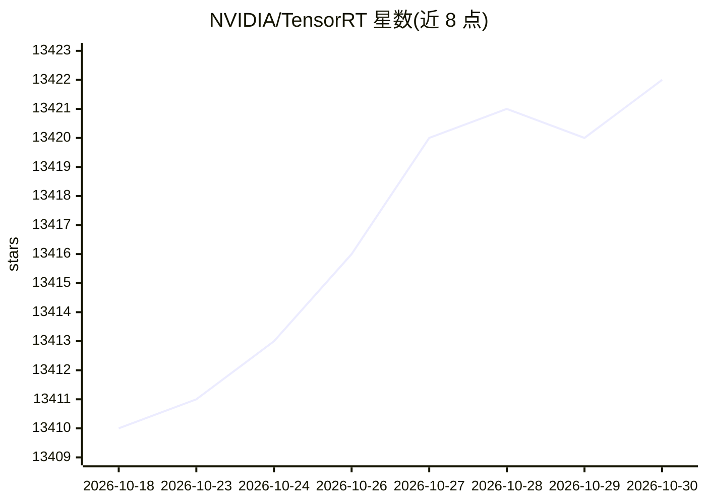

# NVIDIA/TensorRT

⭐ 13,422 · C++ · Apache-2.0 · 推送 2026-10-09 · [GitHub](https://github.com/NVIDIA/TensorRT) · [官网](https://developer.nvidia.com/tensorrt) · 组织维护

**面向开发者的 NVIDIA GPU 深度学习推理 SDK 开源组件仓库**

本仓库包含 NVIDIA TensorRT 的开源组件（OSS）：TensorRT 插件、ONNX 解析器的源码，以及演示平台用法与能力的示例应用。这些开源组件是 TensorRT GA 发布版本的子集，含部分扩展与修复。仓库提供预编译 Python 包的 pip 安装途径，也可通过 Docker 构建容器或本机 CMake 从源码构建，支持 x86-64 与 aarch64（含 Jetson、DriveOS 交叉编译）目标。企业支持通过 NVIDIA AI Enterprise 提供。

## 筛选速览

| 维度 | 判定 | 备注 |
|---|---|---|
| AI 角色 | `ai-ecosystem` | LLM/agent 周边工具 |
| 许可风险 | `permissive` | Apache-2.0 |
| 部署形态 | `self-host` | docker 或自建部署 |
| 模型依赖 | — | README 未给出锁定关系 |
| 硬件要求 | — | 无带数字的原话,不猜 |
| 安装摩擦 | `low` | 无编译、无系统依赖或容器化 |
| 成熟度 | — | 结构信号不足 |

## 动量与使用信号

- 维护:`active` — 距上次 push 8.6 天,年发版 8,84 位贡献者
- 涨星:近 1 天 **+4**(自 20261016 起算)
- 安装:pypi 包 `tensorrt` 月下载 220,819
- 平台:LINUX · 协议:—

## 能力要点

- 包含 TensorRT 插件与 ONNX 解析器源码及示例应用
- 提供 pip install tensorrt 预编译 Python 包安装途径
- 支持 Docker 构建容器与本机 CMake 源码构建，覆盖 x86-64/aarch64 与 Jetson、DriveOS、QNX 交叉编译
- 提供与编码代理（coding agent）配合使用的 TensorRT 使用与基准测试技能

## 适用场景

- 为部署在 NVIDIA GPU 上的模型准备推理所需的插件与解析器组件
- 参考官方示例应用了解 TensorRT 的使用方式
- 为 Jetson 或 DriveOS 等 aarch64 平台交叉编译 TensorRT OSS 组件

## 场景标签

`推理引擎` · 领域:训练与推理

## 证据(README 行号)

> L16: This repository contains the Open Source Software (OSS) components of NVIDIA TensorRT. It includes the sources for 
> L34: We provide the TensorRT Python package for an easy installation. \
> L56: - CUDA

## 星数曲线

2026-10-18 13,410 → 2026-10-30 13,422（+12）

---
*卡片 v1 · prompt 1.4 · 生成 2026-10-18 · 置信度 high · 依据 README sha `2fa0690c213b` · [字段定义](../../DATASET.md)*
