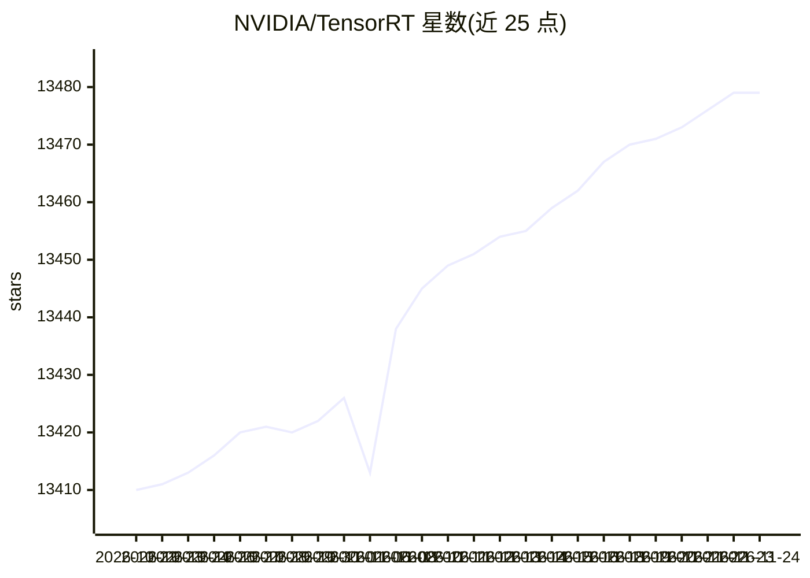

# NVIDIA/TensorRT

⭐ 13,481 · C++ · Apache-2.0 · 推送 2026-11-18 · [GitHub](https://github.com/NVIDIA/TensorRT) · [官网](https://developer.nvidia.com/tensorrt) · 组织维护

**NVIDIA GPU 上的深度学习推理加速 SDK 开源组件**

NVIDIA TensorRT 的开源仓库，包含 TensorRT 的 OSS 组件：插件源码、ONNX 解析器，以及演示平台用法与能力的示例应用；是 TensorRT GA 发布版本的子集并带部分扩展与修复。提供预编译 Python 包（pip install tensorrt）可跳过源码编译；源码构建需 CUDA 等系统依赖，支持 Linux/Windows、x86_64 与 aarch64（含 Jetson/DriveOS 交叉编译），并提供 Docker 构建容器。随 TensorRT 11.X 发布移除了弱类型网络、隐式量化等旧特性并给出迁移指南。

## 筛选速览

| 维度 | 判定 | 备注 |
|---|---|---|
| AI 角色 | `ai-ecosystem` | LLM/agent 周边工具 |
| 许可风险 | `permissive` | Apache-2.0 |
| 部署形态 | `self-host` | docker 或自建部署 |
| 模型依赖 | — | README 未给出锁定关系 |
| 硬件要求 | — | 无带数字的原话,不猜 |
| 安装摩擦 | `low` | 无编译、无系统依赖或容器化 |
| 成熟度 | — | 结构信号不足 |

## 动量与使用信号

- 维护:`active` — 距上次 push 8.6 天,年发版 8,84 位贡献者
- 涨星:近 1 天 **+4**(自 20261016 起算)
- 安装:pypi 包 `tensorrt` 月下载 220,819
- 平台:LINUX · 协议:—

## 能力要点

- 提供预编译 pip 包，可跳过源码编译直接使用
- OSS 组件含插件源码与 ONNX 解析器及示例应用
- 支持 Jetson/DriveOS aarch64 交叉编译与 Docker 构建容器
- 11.X 移除弱类型网络、隐式量化、IPluginV2 等旧 API 并提供迁移指南

## 适用场景

- 在 NVIDIA GPU 上部署并加速深度学习模型推理
- 为 TensorRT 编写自定义插件或使用 ONNX 导入
- 针对 Jetson/DriveOS 嵌入式平台交叉编译推理应用

## 场景标签

`推理引擎` · 领域:训练与推理

## 证据(README 行号)

> L1: License Documentation Roadmap
> L16: This repository contains the Open Source Software (OSS) components of NVIDIA TensorRT. It includes the sources for 
> L56: - CUDA

## 星数曲线

2026-10-22 13,410 → 2026-11-24 13,479（+69）

---
*卡片 v1 · prompt 1.4 · 生成 2026-11-22 · 置信度 high · 依据 README sha `de9ce7c07310` · [字段定义](../../DATASET.md)*
