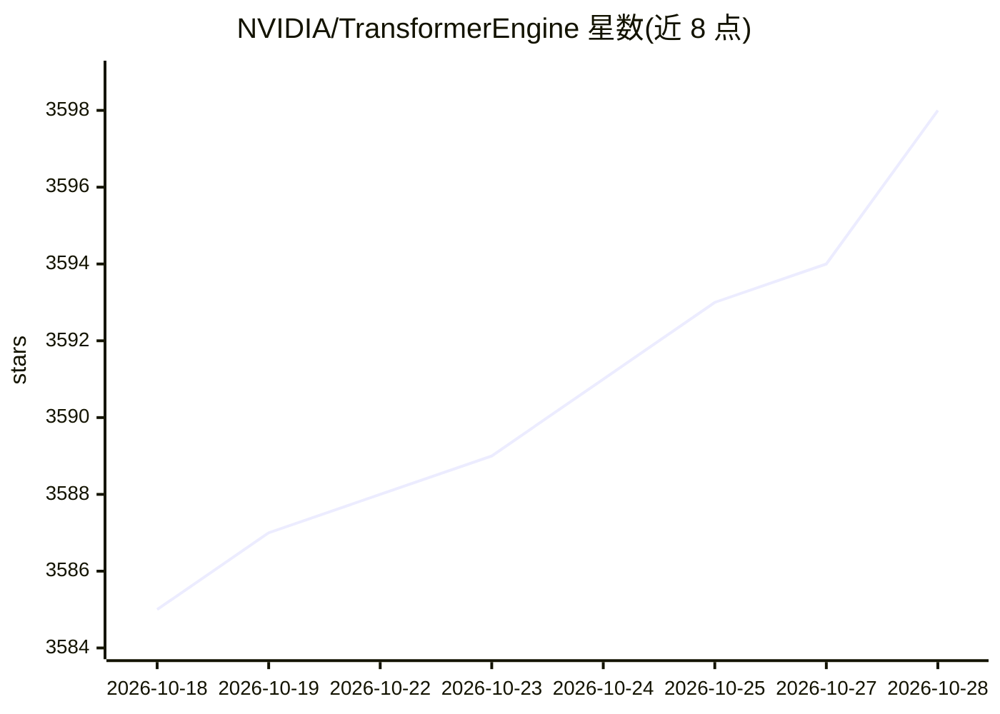

# NVIDIA/TransformerEngine

⭐ 3,598 · Python · Apache-2.0 · 推送 2026-10-27 · [GitHub](https://github.com/NVIDIA/TransformerEngine) · [官网](https://docs.nvidia.com/deeplearning/transformer-engine/) · 组织维护

**NVIDIA GPU 上加速 Transformer 训练的 FP8/FP4 混合精度库**

NVIDIA 维护的 Transformer 模型加速库：为 PyTorch 与 JAX 提供自动混合精度风格 API，在 Hopper、Ada、Blackwell 及 Rubin GPU 上支持 FP8 训练，在 Blackwell 上支持 MXFP8 与 NVFP4。内部管理低精度所需的 scaling factor、amax 历史与量化元数据，模块覆盖 attention、线性层、归一化、MoE 与分布式通信操作，并在 Ampere 及之后架构上优化 FP16/BF16。限制为仅面向 NVIDIA GPU。

## 筛选速览

| 维度 | 判定 | 备注 |
|---|---|---|
| AI 角色 | `ai-ecosystem` | LLM/agent 周边工具 |
| 许可风险 | `permissive` | Apache-2.0 |
| 部署形态 | `self-host` | docker 或自建部署 |
| 模型依赖 | — | README 未给出锁定关系 |
| 硬件要求 | — | 无带数字的原话,不猜 |
| 安装摩擦 | `low` | 无编译、无系统依赖或容器化 |
| 成熟度 | — | 结构信号不足 |

## 能力要点

- FP8 训练支持 Hopper/Ada/Blackwell/Rubin，MXFP8 与 NVFP4 支持 Blackwell
- PyTorch 与 JAX 的 autocast 风格 API，无需重写训练栈即可采用低精度
- 内置 attention、GEMM、归一化、MoE 与融合 Transformer 模块的优化内核
- 管理 scaling factor、amax 历史与量化元数据

## 适用场景

- 在不重写训练代码的前提下将大模型训练切换到 FP8/FP4 低精度
- 降低大规模分布式训练与推理的显存占用
- 加速 MoE 模型训练吞吐

## 场景标签

`模型训练` · 领域:训练与推理

## 证据(README 行号)

> L15: Transformer Engine (TE) is an NVIDIA library for accelerating Transformer model training on NVIDIA GPUs.
> L17: for PyTorch and JAX, so low-precision training can be adopted without rewriting a training stack.

## 星数曲线

2026-10-18 3,585 → 2026-10-28 3,598（+13）

---
*卡片 v1 · prompt 1.4 · 生成 2026-10-21 · 置信度 high · 依据 README sha `1ec6c22fb775` · [字段定义](../../DATASET.md)*
