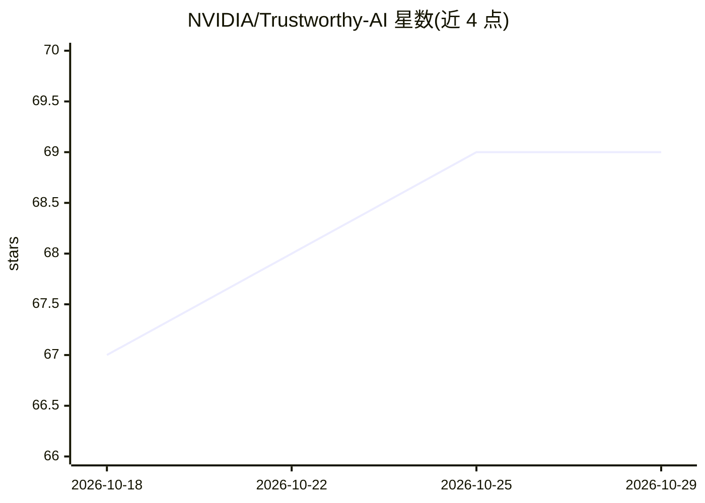

# NVIDIA/Trustworthy-AI

⭐ 69 · Python · CC0-1.0 · 推送 2026-10-26 · [GitHub](https://github.com/NVIDIA/Trustworthy-AI) · 组织维护

**NVIDIA 可信 AI 文档模板与社区工具集合**

NVIDIA 维护的可信 AI（Trustworthy AI）文档仓库：提供 Model Card++、Agent Card、Skill Card、Data Card、System Card 等一系列记录 AI 模型、智能体、数据集与系统透明度、风险与使用限制的模板；包含 ASL（美国手语）数据管线的代码、测试与 notebook、SIGNS 项目的模型卡、治理技能卡生成脚本及 CycloneDX 属性分类文档。各组件分别以 CC0、CC-BY、Apache-2.0 及 NVIDIA 数据许可发布。

## 筛选速览

| 维度 | 判定 | 备注 |
|---|---|---|
| AI 角色 | `ai-knowledge` | 知识聚合/清单类 |
| 许可风险 | `viral` | CC0-1.0 |
| 部署形态 | `library` | 以包/库形式分发 |
| 模型依赖 | — | README 未给出锁定关系 |
| 硬件要求 | — | 无带数字的原话,不猜 |
| 安装摩擦 | `low` | 无编译、无系统依赖或容器化 |
| 成熟度 | — | 结构信号不足 |

## 能力要点

- 覆盖模型/智能体/技能/数据/系统/容器/Helm 图的多类透明度文档模板
- ASL 数据管线代码、测试与 notebook（Apache-2.0）
- 治理技能卡生成脚本与 CycloneDX 属性分类文档

## 适用场景

- 为 AI 模型或系统编写标准化的透明度与风险文档
- 参与 ASL 数据管线或文档模板的开源贡献
- 查找 AI 治理相关卡片模板参考

## 场景标签

 · 领域:AI 治理/文档

## 证据(README 行号)

> L9: This repository contains Trustworthy AI documentation templates, example cards, and community tools. Use the table b
> L13: |Model Card++ Templates/|Templates for documenting AI model transparency, risks, usage, and limitations. See the mo

## 星数曲线

2026-10-18 67 → 2026-10-29 69（+2）

---
*卡片 v1 · prompt 1.4 · 生成 2026-10-24 · 置信度 high · 依据 README sha `5ad6c0a226b6` · [字段定义](../../DATASET.md)*
