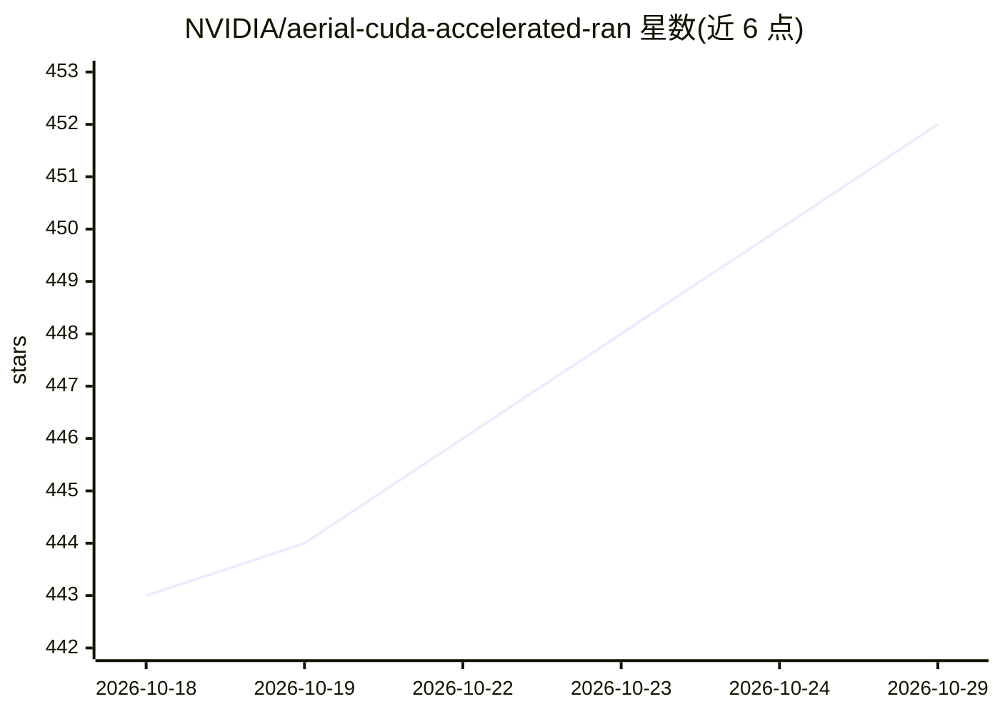

# NVIDIA/aerial-cuda-accelerated-ran

⭐ 452 · C++ · NOASSERTION · 推送 2026-09-16 · [GitHub](https://github.com/NVIDIA/aerial-cuda-accelerated-ran) · [官网](https://docs.nvidia.com/aerial/cuda-accelerated-ran/latest/index.html) · 组织维护

**面向 NVIDIA GPU 的 5G/6G 基站软件 SDK，构建 O-RAN 合规 gNB**

NVIDIA Aerial CUDA-Accelerated RAN 是用于构建商用级、符合 3GPP 与 O-RAN 规范的 5G/6G gNB 软件的 SDK，属 NVIDIA AI Aerial 产品组合的组成部分。包含 CUDA 物理层处理（LDPC/Polar 编码、MIMO、信道估计）、GPU 加速 MAC 调度器、供 AI/ML 研究使用的 Python 绑定 pyAerial、基于 MATLAB 的 5G 参考模型，以及预构建 Docker 容器的开发部署环境。面向无线通信开发与研究人员，运行依赖 NVIDIA 加速计算平台与 CUDA。仓库以 Apache 2.0 许可，当前不接受社区贡献。

## 筛选速览

| 维度 | 判定 | 备注 |
|---|---|---|
| AI 角色 | `ai-ecosystem` | LLM/agent 周边工具 |
| 许可风险 | `none` | NOASSERTION |
| 部署形态 | `None` |  |
| 模型依赖 | — | README 未给出锁定关系 |
| 硬件要求 | — | 无带数字的原话,不猜 |
| 安装摩擦 | `medium` | 含编译或系统依赖之一 |
| 成熟度 | — | 结构信号不足 |

## 能力要点

- CUDA 加速 5G 物理层（cuPHY）：LDPC/Polar 编码、调制解调、MIMO、信道估计
- GPU 加速 L2 MAC 调度器（cuMAC）
- pyAerial Python 绑定，支持与 TensorFlow、Sionna 集成
- Docker 预构建容器开发与部署环境

## 适用场景

- 在 NVIDIA GPU 平台上构建商用级 5G gNB 软件栈
- AI/ML 无线研究：用 pyAerial 结合 TensorFlow/Sionna 做实验
- 生成基于 3GPP 规范的 5G 波形与测试向量

## 场景标签

 · 领域:电信/无线通信基础设施

## 证据(README 行号)

> L1: # NVIDIA Aerial™ CUDA-Accelerated RAN
> L20: - **Python API (pyAerial)**: Python bindings for AI/ML research and integration with frameworks like TensorFlow and

## 星数曲线

2026-10-18 443 → 2026-10-29 452（+9）

---
*卡片 v1 · prompt 1.4 · 生成 2026-10-21 · 置信度 mid · 依据 README sha `2e1d365d2843` · [字段定义](../../DATASET.md)*
