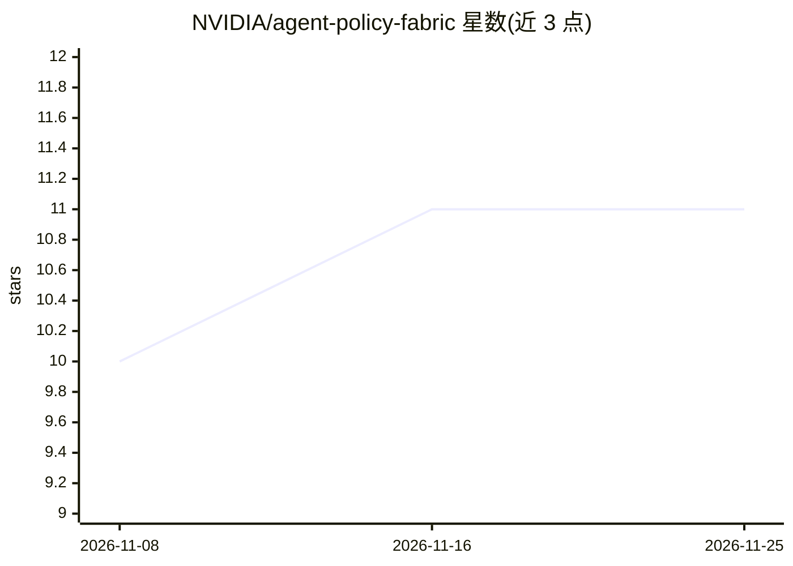

# NVIDIA/agent-policy-fabric

⭐ 11 · Rust · Apache-2.0 · 推送 2026-11-03 · [GitHub](https://github.com/NVIDIA/agent-policy-fabric) · [官网](https://docs.nvidia.com/agent-policy-fabric) · 组织维护

**企业级 agent 策略层：一份签名策略在准入与每次请求时执行**

APF 管控 agentic 工作负载可执行的操作：策略独立于执行环境编写并签名一次，由企业而非开发者或 agent 设定规则。执行机制为分层拦截：沙箱准入（OpenShell 集成）注入编译后的 SandboxPolicy，网关拦截器与 Supervisor 中间件在每次出站请求时评估并返回决策；热路径无云端往返。由 NVIDIA 主导开发，社区贡献需符合项目目标，采用 Apache 2.0 许可。

## 筛选速览

| 维度 | 判定 | 备注 |
|---|---|---|
| AI 角色 | `ai-ecosystem` | LLM/agent 周边工具 |
| 许可风险 | `permissive` | Apache-2.0 |
| 部署形态 | `library` | 以包/库形式分发 |
| 模型依赖 | — | README 未给出锁定关系 |
| 硬件要求 | — | 无带数字的原话,不猜 |
| 安装摩擦 | `low` | 无编译、无系统依赖或容器化 |
| 成熟度 | — | 结构信号不足 |

## 能力要点

- 签名策略一次编写，准入与每层请求均执行
- Gateway 拦截器注入编译后的 SandboxPolicy
- Supervisor 中间件逐请求评估出站决策
- 策略编译/签名/分发/评估无需热路径云往返

## 适用场景

- 企业统一管控 agent 可调用的工具与操作
- 为多套 agent 运行环境下发一致的安全策略
- 对 agent 出站请求逐次做策略合规判定

## 场景标签

`网络安全` · 领域:学习与行业

## 证据(README 行号)

> L5: APF governs what agentic workloads are allowed to do. Policy is authored and signed once,
> L12: Every agent follows one governed path: admitted once under signed policy, then gated at every

## 星数曲线

2026-11-08 10 → 2026-11-25 11（+1）

---
*卡片 v1 · prompt 1.4 · 生成 2026-11-19 · 置信度 mid · 依据 README sha `ce1656f231ef` · [字段定义](../../DATASET.md)*
