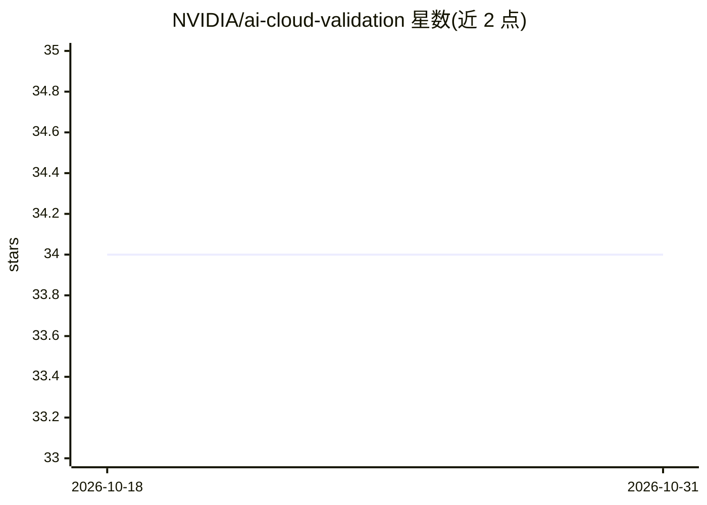

# NVIDIA/ai-cloud-validation

⭐ 34 · Python · Apache-2.0 · 推送 2026-10-25 · [GitHub](https://github.com/NVIDIA/ai-cloud-validation) · [官网](https://www.nvidia.com/en-us/data-center/isv-validation-program/) · 组织维护

**面向 NVIDIA 硬件云环境的 AI 负载验证测试框架**

NVIDIA 维护的 ISV Lab 环境验证与管理工具集：以一组可扩展测试检验云系统能否支撑 AI 训练、推理及 AI 应用运行等负载。框架将高层需求映射到 stub 函数（如“创建虚拟机”），可对 AWS 等既有云平台执行直接验证或组合验证；提供 isvctl 控制器、isvtest 验证框架、isvreporter 报告组件，支持 my-isv 脚手架自定义平台与 demo 模式。通过 git clone + uv 安装运行。

## 筛选速览

| 维度 | 判定 | 备注 |
|---|---|---|
| AI 角色 | `ai-ecosystem` | LLM/agent 周边工具 |
| 许可风险 | `permissive` | Apache-2.0 |
| 部署形态 | `None` |  |
| 模型依赖 | — | README 未给出锁定关系 |
| 硬件要求 | — | 无带数字的原话,不猜 |
| 安装摩擦 | `low` | 无编译、无系统依赖或容器化 |
| 成熟度 | — | 结构信号不足 |

## 能力要点

- 将高层需求映射到 stub 函数的灵活测试集
- 验证云系统对 AI 训练、推理与 AI 应用的支撑能力
- isvctl/isvtest/isvreporter 三组件结构
- my-isv 脚手架支持自定义平台与 demo 预演

## 适用场景

- 对运行 NVIDIA 硬件的云环境做 AI 负载能力验证
- 为新云平台编写验证 stub 并接入测试管线
- 以 AWS 参考实现学习各验证域的用法

## 场景标签

 · 领域:AI 云基础设施/测试验证

## 证据(README 行号)

> L9: The AI Cloud Validation suite is a test framework for validating that developers and compute providers get the most 
> L11: It consists of a very flexible set of tests, which ensure that a system is able to support AI training, inferencing
> L13: This validation suite is meant to be run against an existing cloud system, specifically one that is running NVIDIA 

## 星数曲线

2026-10-18 34 → 2026-10-31 34（+0）

---
*卡片 v1 · prompt 1.4 · 生成 2026-10-25 · 置信度 high · 依据 README sha `6b1320219b82` · [字段定义](../../DATASET.md)*
