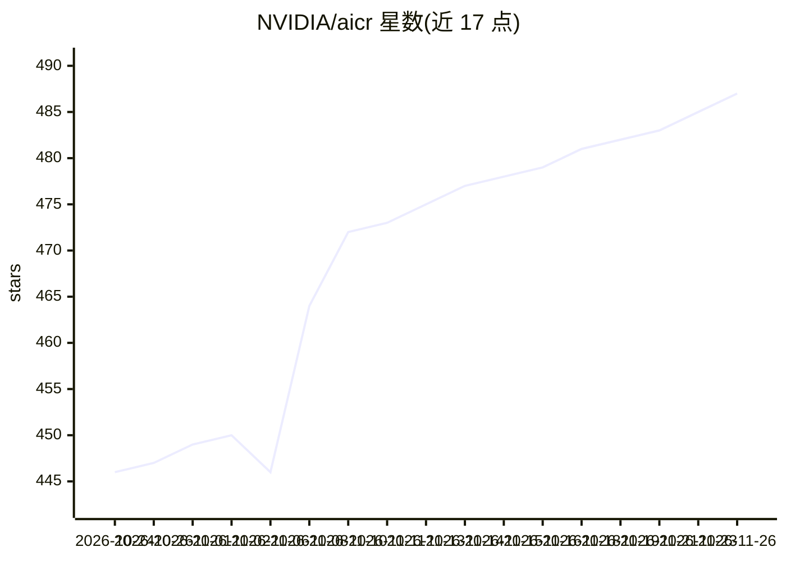

# NVIDIA/aicr

⭐ 487 · Go · Apache-2.0 · 推送 2026-11-25 · [GitHub](https://github.com/NVIDIA/aicr) · [官网](https://docs.nvidia.com/aicr/) · 组织维护

**为 GPU 加速 Kubernetes 集群生成经过验证的运行时配置**

NVIDIA 开源的 AICR 通过 version-locked recipe 捕获驱动、operator、内核与系统配置的已验证组合，并可渲染为 Helm、Argo CD、Flux、Helmfile、Terraform、Rancher Fleet 等部署产物。提供单二进制 CLI、REST API 服务（aicrd）、Go SDK 与快照 Agent；支持部署、性能（训练/推理）与一致性多阶段校验，以及快照间漂移检测和 Cosign/Sigstore 签名的供应链验证。目标用户是搭建 GPU 加速 Kubernetes 集群的工程团队；README 明确其不是 Kubernetes 发行版或集群生命周期管理器。

## 筛选速览

| 维度 | 判定 | 备注 |
|---|---|---|
| AI 角色 | `ai-ecosystem` | LLM/agent 周边工具 |
| 许可风险 | `permissive` | Apache-2.0 |
| 部署形态 | `library` | 以包/库形式分发 |
| 模型依赖 | — | README 未给出锁定关系 |
| 硬件要求 | — | 无带数字的原话,不猜 |
| 安装摩擦 | `low` | 无编译、无系统依赖或容器化 |
| 成熟度 | — | 结构信号不足 |

## 能力要点

- recipe 渲染为 7 种部署器产物（Helm/Argo CD/Flux/Helmfile/Terraform/Fleet/helm）
- CLI 单二进制覆盖 snapshot/recipe/bundle/validate/verify/diff 全流程
- 多阶段校验：部署、性能（训练与推理）、一致性
- SLSA Build Level 3 溯源、签名 SBOM 与离线 bundle 验证

## 适用场景

- 为特定云、GPU、OS 与工作负载组合生成可复现的集群运行时配置
- 在 CI/CD 或离线环境中通过 REST API 集成集群配置流程
- 对比两个快照检测集群配置漂移

## 场景标签

`代码生成` · 领域:编码与开发

## 证据(README 行号)

> L7: AI Cluster Runtime (AICR) makes it easy to stand up GPU-accelerated Kubernetes clusters. It captures known-good comb
> L46: |**`aicr` CLI**|Single binary for the full workflow: snapshot, recipe, bundle, validate, verify, diff, and trust ma
> L96: At its core, AICR is a cluster configuration generator. You bring your GPU-accelerated Kubernetes cluster and your 

## 星数曲线

2026-10-24 446 → 2026-11-26 487（+41）

---
*卡片 v1 · prompt 1.4 · 生成 2026-11-25 · 置信度 high · 依据 README sha `afa8d452c8a6` · [字段定义](../../DATASET.md)*
