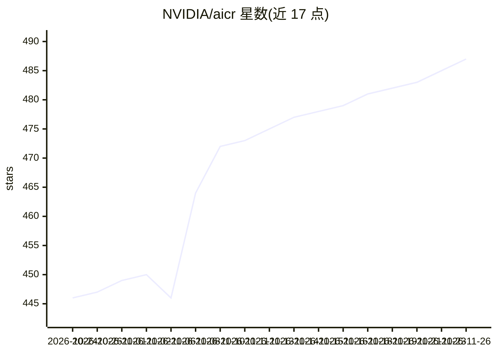

# NVIDIA/aicr

⭐ 487 · Go · Apache-2.0 · 推送 2026-11-25 · [GitHub](https://github.com/NVIDIA/aicr) · [官网](https://docs.nvidia.com/aicr/) · 组织维护

**NVIDIA 出品：为 K8s GPU 集群生成与验证 AI 运行时配置**

面向在 Kubernetes 上运维 GPU 加速 AI 集群的团队：通过快照代理采集集群能力（GPU、驱动、内核、OS），匹配版本锁定的配方（recipe），渲染为 Helm、Argo CD、Flux、Helmfile、Terraform、Rancher Fleet 等部署工件，并支持部署、性能与一致性多阶段验证。配方携带签名来源与验证证明，支持离线校验、漂移检测与自建目录。以 CLI 单二进制、REST API 服务（aicrd）与 Go SDK 三种形态提供。明确不自建 K8s 发行版或集群生命周期管理。

## 筛选速览

| 维度 | 判定 | 备注 |
|---|---|---|
| AI 角色 | `ai-ecosystem` | LLM/agent 周边工具 |
| 许可风险 | `permissive` | Apache-2.0 |
| 部署形态 | `library` | 以包/库形式分发 |
| 模型依赖 | — | README 未给出锁定关系 |
| 硬件要求 | — | 无带数字的原话,不猜 |
| 安装摩擦 | `low` | 无编译、无系统依赖或容器化 |
| 成熟度 | — | 结构信号不足 |

## 能力要点

- 单一 CLI 覆盖 snapshot、recipe、bundle、validate、verify、diff 全流程
- 同一配方可渲染为 Helm/Argo CD/Flux/Helmfile/Terraform/Fleet 六类部署工件
- 配方携带签名 provenance 与验证 attestation，支持离线验证与 SLSA L3 供应链证明
- 内置目录覆盖 A100/H100/B200 等加速器与多种 K8s 服务环境

## 适用场景

- 为 GPU 集群生成可复现的驱动与组件部署配置
- 用签名验证结果固化团队已验证的软硬组合
- 检测两个集群间或不同时间点的配置漂移
- CI/CD 或气隙环境中通过 REST API 集成配方生成与校验

## 场景标签

 · 领域:云基础设施/K8s 运维

## 证据(README 行号)

> L7: AI Cluster Runtime (AICR) is an open source project created by NVIDIA. It provides a common workflow for discovering
> L17: AICR captures known-good combinations of drivers, operators, kernels, and system configurations as version-locked *
> L100: At its core, AICR is a cluster configuration generator. You bring your GPU-accelerated Kubernetes cluster and your

## 星数曲线

2026-10-24 446 → 2026-11-26 487（+41）

---
*卡片 v1 · prompt 1.4 · 生成 2026-11-26 · 置信度 high · 依据 README sha `ef1f97e11ae7` · [字段定义](../../DATASET.md)*
