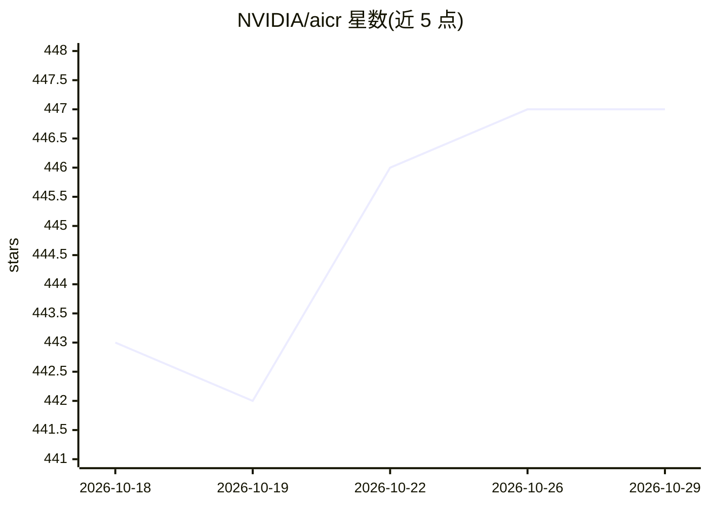

# NVIDIA/aicr

⭐ 447 · Go · Apache-2.0 · 推送 2026-10-28 · [GitHub](https://github.com/NVIDIA/aicr) · [官网](https://docs.nvidia.com/aicr/) · 组织维护

**为运维/平台团队生成并验证 GPU K8s 集群的版本锁定运行时配置**

NVIDIA 的 GPU 加速 Kubernetes 集群配置工具：将经过验证的驱动、Operator、内核与系统配置组合固化为版本锁定的 recipe（配方），渲染为 Helm、Argo CD、Flux、Helmfile、Terraform 或 Fleet 的部署工件。提供 aicr CLI、REST API 服务（aicrd）、Go SDK 与集群快照 Agent，支持部署/性能/一致性多阶段验证与配置漂移对比，工件带 SLSA 与 Sigstore 签名可离线验证。使用前提是用户已有 GPU K8s 集群，AICR 本身不负责集群创建与生命周期管理。

## 筛选速览

| 维度 | 判定 | 备注 |
|---|---|---|
| AI 角色 | `ai-ecosystem` | LLM/agent 周边工具 |
| 许可风险 | `permissive` | Apache-2.0 |
| 部署形态 | `library` | 以包/库形式分发 |
| 模型依赖 | — | README 未给出锁定关系 |
| 硬件要求 | — | 无带数字的原话,不猜 |
| 安装摩擦 | `low` | 无编译、无系统依赖或容器化 |
| 成熟度 | — | 结构信号不足 |

## 能力要点

- 版本锁定 recipe 渲染为 Helm/Argo CD/Flux/Helmfile/Terraform/Fleet 多种部署工件
- aicr CLI + aicrd REST API + Go SDK + 集群快照 Agent 的完整工作流
- 部署/性能/一致性多阶段验证与 aicr diff 配置漂移检测
- SLSA Build L3 出处签名与 Cosign/Sigstore 工件离线验证

## 适用场景

- 为 GPU 训练/推理集群交付可复现的运行时配置
- 在 CI/CD 或气隙环境中通过 REST API 集成配置验证
- 跨集群或随时间检测配置漂移

## 场景标签

 · 领域:AI 基础设施/Kubernetes 运维

## 证据(README 行号)

> L7: AI Cluster Runtime (AICR) makes it easy to stand up GPU-accelerated Kubernetes clusters. It captures known-good comb
> L92: At its core, AICR is a cluster configuration generator. You bring your GPU-accelerated Kubernetes cluster and your 

## 星数曲线

2026-10-18 443 → 2026-10-29 447（+4）

---
*卡片 v1 · prompt 1.4 · 生成 2026-10-21 · 置信度 high · 依据 README sha `677bd059a36e` · [字段定义](../../DATASET.md)*
