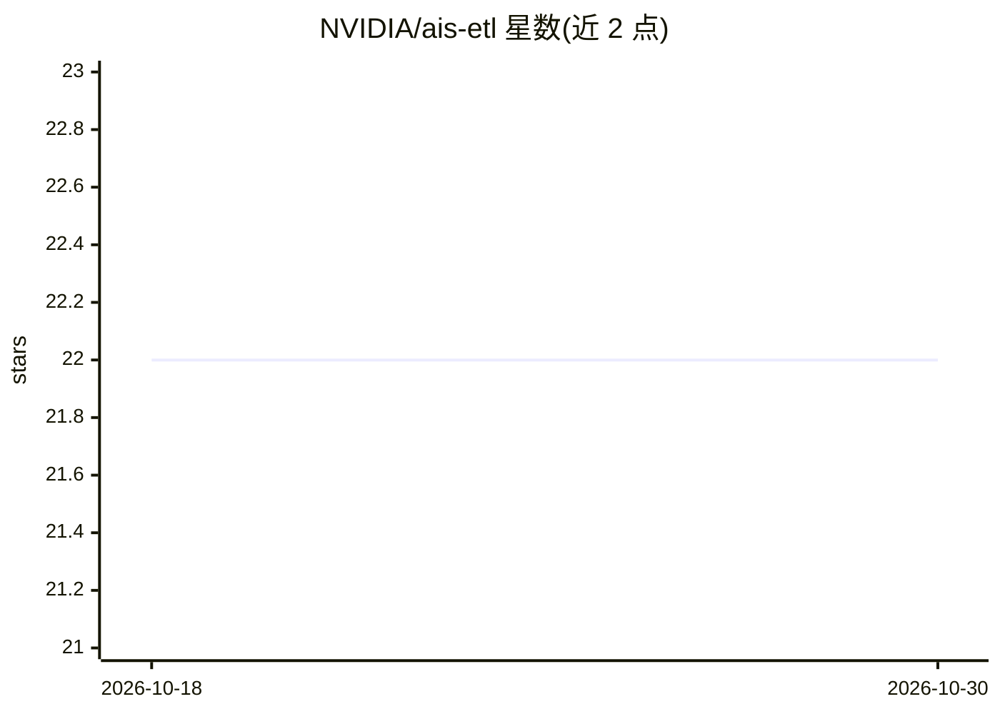

# NVIDIA/ais-etl

⭐ 22 · Python · MIT · 推送 2026-10-21 · [GitHub](https://github.com/NVIDIA/ais-etl) · 组织维护

**在 AIStore 集群上部署自定义 ETL 容器的组件与示例**

NVIDIA 维护的 AIStore ETL 仓库：提供可部署到 AIStore 集群的现成 transformer、init_class 运行时定义，以及本地开发（kind/minikube）与生产级 Kubernetes 两套参考部署方案。ETL 功能需使用带 -etl 后缀的 aisnode 镜像或源码加 etl 构建标签，支持并行、在线或离线地就近处理用户数据。仓库声明处于 beta 阶段，不保证向后兼容，且用户代码在容器内运行存在安全风险，AuthN 暂无细粒度 ETL 权限控制。

## 筛选速览

| 维度 | 判定 | 备注 |
|---|---|---|
| AI 角色 | `ai-ecosystem` | LLM/agent 周边工具 |
| 许可风险 | `permissive` | MIT |
| 部署形态 | `self-host` | docker 或自建部署 |
| 模型依赖 | — | README 未给出锁定关系 |
| 硬件要求 | — | 无带数字的原话,不猜 |
| 安装摩擦 | `low` | 无编译、无系统依赖或容器化 |
| 成熟度 | `idea` | |

## 能力要点

- 提供现成 ETL transformers 与 init_class 运行时定义
- 本地 kind/minikube 与生产级 K8s 两套参考部署
- 需 ETL-enabled aisnode 镜像或 TAGS=etl 源码构建

## 适用场景

- 在 AIStore 集群上就近对数据做并行抽取-转换-加载
- 开发并注册自定义 ETL transformer 做功能测试
- 搭建带 ETL 能力的 AIStore 生产集群

## 场景标签

`MLOps` · 领域:训练与推理

## 证据(README 行号)

> L3: This repository contains the components and examples used to run **Extract-Transform-Load (ETL)** operations on an A
> L17: To begin using ETLs in AIStore, deploy an AIStore cluster on Kubernetes using an ETL-enabled `aisnode` build. ETL i

## 星数曲线

2026-10-18 22 → 2026-10-30 22（+0）

---
*卡片 v1 · prompt 1.4 · 生成 2026-10-27 · 置信度 mid · 依据 README sha `a7a0ece91838` · [字段定义](../../DATASET.md)*
