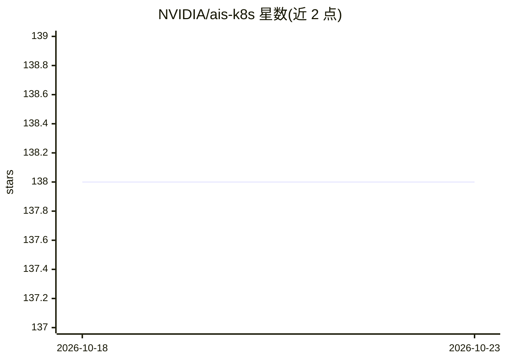

# NVIDIA/ais-k8s

⭐ 138 · Go · MIT · 推送 2026-10-21 · [GitHub](https://github.com/NVIDIA/ais-k8s) · 组织维护

**AIStore 在 Kubernetes 上大规模部署的运维工具集**

NVIDIA 维护的 AIStore（面向 AI 应用的轻量级可扩展对象存储）Kubernetes 部署工具集，包含 AIS K8s Operator（负责引导、部署、扩缩容、优雅关停与升级，扩展 Kubernetes 原生 API）、Helm Charts、用于准备 worker 节点的 Ansible Playbooks，以及监控栈的 Helm charts 与说明。README 面向多节点、每节点多盘的生产级部署，并称 Operator 是管理生产级 AIS 集群的唯一推荐支持方式；小规模实验部署需参考其他部署选项。

## 筛选速览

| 维度 | 判定 | 备注 |
|---|---|---|
| AI 角色 | `ai-ecosystem` | LLM/agent 周边工具 |
| 许可风险 | `permissive` | MIT |
| 部署形态 | `library` | 以包/库形式分发 |
| 模型依赖 | — | README 未给出锁定关系 |
| 硬件要求 | — | 无带数字的原话,不猜 |
| 安装摩擦 | `low` | 无编译、无系统依赖或容器化 |
| 成熟度 | — | 结构信号不足 |

## 能力要点

- AIS K8s Operator 自动化集群生命周期（引导/部署/扩缩容/升级）
- Helm Charts 部署由 Operator 管理的 AIS 资源
- Ansible Playbooks 准备承载 AIStore 的 K8s worker 节点
- 提供 K8s 监控栈的 Helm charts 与搭建说明

## 适用场景

- 在多节点 Kubernetes 集群上部署生产级 AIStore 对象存储
- 自动化管理 AIStore 集群的扩缩容与升级
- 为 AIStore 集群搭建监控体系

## 场景标签

 · 领域:存储/云原生基础设施

## 证据(README 行号)

> L4: AIStore is a lightweight, scalable object storage solution designed for AI applications.
> L11: - **Kubernetes Operator**: The AIS K8s Operator simplifies critical tasks such as bootstrapping, deployment, scalin

## 星数曲线

2026-10-18 138 → 2026-10-23 138（+0）

---
*卡片 v1 · prompt 1.4 · 生成 2026-10-22 · 置信度 high · 依据 README sha `bb2dc1b2ddbf` · [字段定义](../../DATASET.md)*
