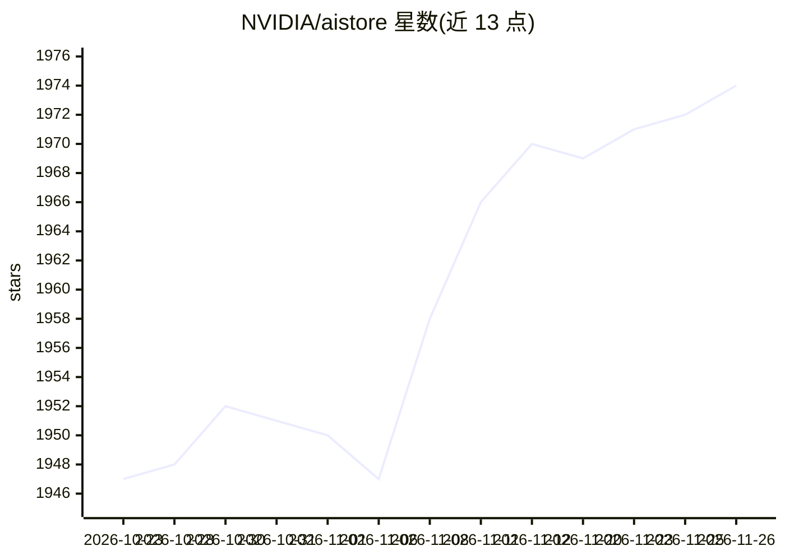

# NVIDIA/aistore

⭐ 1,974 · Go · MIT · 推送 2026-11-25 · [GitHub](https://github.com/NVIDIA/aistore) · [官网](https://docs.nvidia.com/aistore) · 组织维护

**面向 AI 应用的分布式对象存储集群**

AIStore（AIS）是为 AI 应用设计的轻量级分布式存储栈，可在单台 Linux 机器到任意规模裸金属集群上部署，支持有无 Kubernetes 两种方式。提供多云后端接入（S3/GCS/Azure/OCI）、S3 兼容 API、Go/Python SDK、CLI、Prometheus/Grafana 监控、JWT 认证、纠删码与 n-way 镜像等高可用机制。面向 ML/AI 流水线提供 Get-Batch 批量取数、ETL 卸载、TAR 等归档格式原生支持，并带有 PyTorch 数据集/采样器/dataloader 集成与 Boto3 支持。

## 筛选速览

| 维度 | 判定 | 备注 |
|---|---|---|
| AI 角色 | `ai-enhanced` | 去掉 AI 部分产品仍成立 |
| 许可风险 | `permissive` | MIT |
| 部署形态 | `library` | 以包/库形式分发 |
| 模型依赖 | — | README 未给出锁定关系 |
| 硬件要求 | — | 无带数字的原话,不猜 |
| 安装摩擦 | `low` | 无编译、无系统依赖或容器化 |
| 成熟度 | — | 结构信号不足 |

## 能力要点

- 多云后端统一接入与 S3 兼容 API
- Get-Batch 单次调用取回整个训练批次并组装 TAR
- ETL 卸载：在数据近端执行 inline/offline 数据转换（需 etl 构建）
- 30+ 异步批量作业（copy/prefetch/archive/EC/rebalance 等）

## 适用场景

- 为模型训练提供高吞吐训练数据读取
- 统一管理分布在多个云上的数据桶
- 在存储近端执行批量数据转换
- 以 S3 兼容接口替换现有 S3 工具链的后端

## 场景标签

 · 领域:存储基础设施/AI 数据管道

## 证据(README 行号)

> L6: AIStore (AIS) is a lightweight distributed storage stack tailored for AI applications. It's an elastic cluster that 
> L26: * ✅ **ETL Offload:** Execute I/O intensive data transformations close to the data, either inline (on-the-fly as par
> L79: * PyTorch integration and usage examples

## 星数曲线

2026-10-23 1,947 → 2026-11-26 1,974（+27）

---
*卡片 v1 · prompt 1.4 · 生成 2026-11-23 · 置信度 high · 依据 README sha `43386b54f65a` · [字段定义](../../DATASET.md)*
