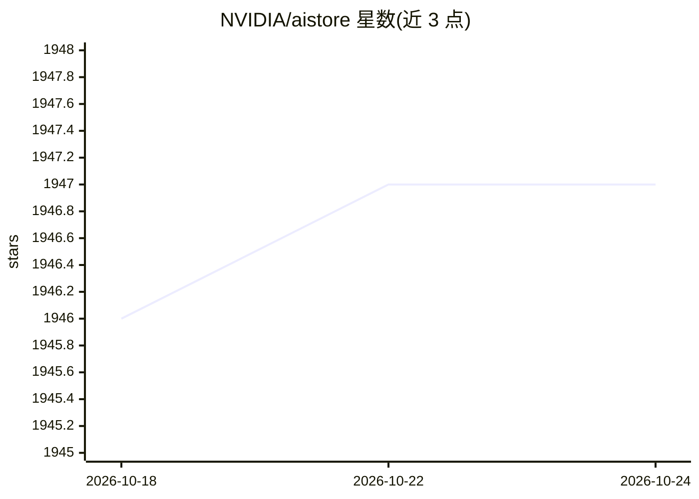

# NVIDIA/aistore

⭐ 1,947 · Go · MIT · 推送 2026-10-24 · [GitHub](https://github.com/NVIDIA/aistore) · [官网](https://docs.nvidia.com/aistore) · 组织维护

**面向 AI 工作负载的分布式对象存储集群**

AIStore（AIS）是 NVIDIA 维护的轻量级分布式存储系统，为 AI/ML 训练与数据管道提供可弹性伸缩的集群：支持单台 Linux 机器到裸机集群、可带或不带 Kubernetes 部署。原生访问 AWS S3、GCS、Azure、OCI 等多云后端，兼容 Amazon S3 API，提供 Go/Python SDK、CLI、PyTorch 集成、ETL 卸载、Get-Batch 训练批取数、分块对象、n-way 镜像与纠删码等高可用机制。MIT 许可。

## 筛选速览

| 维度 | 判定 | 备注 |
|---|---|---|
| AI 角色 | `ai-ecosystem` | LLM/agent 周边工具 |
| 许可风险 | `permissive` | MIT |
| 部署形态 | `library` | 以包/库形式分发 |
| 模型依赖 | — | README 未给出锁定关系 |
| 硬件要求 | — | 无带数字的原话,不猜 |
| 安装摩擦 | `low` | 无编译、无系统依赖或容器化 |
| 成熟度 | — | 结构信号不足 |

## 能力要点

- 多云后端原生访问（S3/GCS/Azure/OCI）且兼容 Amazon S3 API
- ETL 就近卸载与 Get-Batch 单次取整训练批（TAR 组装）
- 30+ 集群级批处理作业与集成 CLI
- PyTorch datasets/samplers/dataloaders 集成与 Boto3 支持

## 适用场景

- 为 ML 训练管道提供可线性扩展的高速数据存储
- 在不迁移数据的前提下透明访问云端数据集
- 在 Kubernetes 上做生产级部署并配合监控运维
- 就近执行数据转换（ETL）减少 I/O 开销

## 场景标签

 · 领域:AI 基础设施/分布式存储

## 证据(README 行号)

> L7: AIStore (AIS) is a lightweight distributed storage stack tailored for AI applications. It's an elastic cluster that 
> L27: * ✅ **Get-Batch:** Retrieve multiple objects and/or archived files with a single call. Designed for ML/AI pipelines
> L64: * PyTorch integration and usage examples

## 星数曲线

2026-10-18 1,946 → 2026-10-24 1,947（+1）

---
*卡片 v1 · prompt 1.4 · 生成 2026-10-21 · 置信度 high · 依据 README sha `50bf26af74f2` · [字段定义](../../DATASET.md)*
