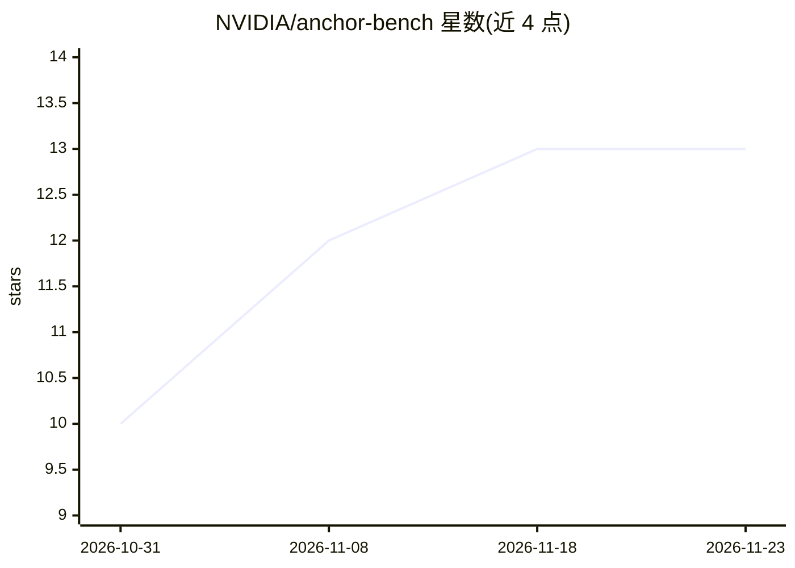

# NVIDIA/anchor-bench

⭐ 13 · Python · Apache-2.0 · 推送 2026-11-20 · [GitHub](https://github.com/NVIDIA/anchor-bench) · 组织维护

**为机器人执行器建模与调参的配置驱动工具库**

Anchor Bench 是 NVIDIA DevTech 的配置驱动工具库，面向机器人执行器工作流：校验 YAML 任务配置、运行对应实现、在指定输出目录写入可复现产物。支持三类任务——生成分段执行器指令轨迹（trajectory_v1）、在复制的 Newton 世界中回放记录数据拟合执行器参数（actuator_sys_id）、准备映射轨迹并训练循环执行器模型（training）。附带支持 Hugging Face 来源（revision 锁定）的 Parquet 数据加载器、Newton USD 适配器与可选 MLflow 运行追踪。要求 Python 3.10+，用 uv 管理环境。

## 筛选速览

| 维度 | 判定 | 备注 |
|---|---|---|
| AI 角色 | `ai-native` | 本体是模型或模型工具 |
| 许可风险 | `permissive` | Apache-2.0 |
| 部署形态 | `None` |  |
| 模型依赖 | — | README 未给出锁定关系 |
| 硬件要求 | — | 无带数字的原话,不猜 |
| 安装摩擦 | `low` | 无编译、无系统依赖或容器化 |
| 成熟度 | `idea` | |

## 能力要点

- 三类任务：轨迹生成、执行器系统辨识、循环模型训练
- YAML 配置校验 + 可复现产物输出目录（含 .completed 标记）
- Parquet 数据加载器，支持 revision 锁定的 Hugging Face 来源
- Newton USD 适配器与可选 MLflow 追踪后端

## 适用场景

- 为机器人执行器生成分段指令轨迹
- 回放真实记录数据辨识执行器参数
- 训练并验证循环执行器模型
- 用 MLflow 追踪物理 AI 训练实验

## 场景标签

 · 领域:机器人/物理 AI

## 证据(README 行号)

> L16: |`actuator_sys_id`|Fit actuator parameters by replaying recorded data in replicated Newton worlds.|
> L17: |`training`|Prepare mapped trajectories and train recurrent actuator models.|

## 星数曲线

2026-10-31 10 → 2026-11-23 13（+3）

---
*卡片 v1 · prompt 1.4 · 生成 2026-11-18 · 置信度 mid · 依据 README sha `36ad63ab6f8c` · [字段定义](../../DATASET.md)*
