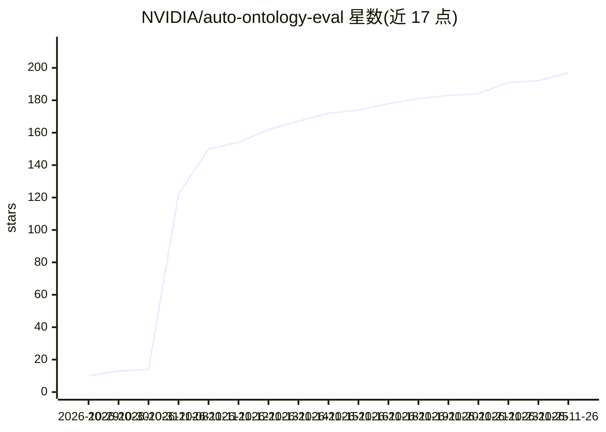

# NVIDIA/auto-ontology-eval

⭐ 197 · Python · Apache-2.0 · 推送 2026-11-25 · [GitHub](https://github.com/NVIDIA/auto-ontology-eval) · 组织维护

**量化 Auto-Ontology 本体对 text-to-SQL 准确率提升幅度的评测工具包**

NVIDIA 开源的 text-to-SQL 评测工具包，用于度量 Auto-Ontology 本体在同一模型上带来的准确率差异。流程分三步：将数据库 schema 摄入 pgvector 目录并编译本体；在 NeMo Gym 上以双臂设计运行——对照臂仅给 schema、实验臂经 Auto-Ontology agent 检索本体上下文；再用确定性执行验证器对照 gold SQL 打分（BIRD 执行准确率 / BEAVER ex_acc），输出准确率差值及被修复/破坏的问题清单。内置 BIRD、BEAVER 等 5 个基准，支持自有数据集接入；依赖 uv、Python 3.13 与带 pgvector 的 Postgres。

## 筛选速览

| 维度 | 判定 | 备注 |
|---|---|---|
| AI 角色 | `ai-ecosystem` | LLM/agent 周边工具 |
| 许可风险 | `permissive` | Apache-2.0 |
| 部署形态 | `self-host` | docker 或自建部署 |
| 模型依赖 | — | README 未给出锁定关系 |
| 硬件要求 | — | 无带数字的原话,不猜 |
| 安装摩擦 | `low` | 无编译、无系统依赖或容器化 |
| 成熟度 | — | 结构信号不足 |

## 能力要点

- 对照/实验双臂设计，隔离本体相对纯 schema 的增量贡献
- 确定性 SQL 执行验证器打分，无 LLM 评审
- 覆盖率超 5% 时拒绝输出头条数字，防止限流结果被误读
- 支持自有数据集注册与多轮 BIRD-Interact 评测

## 适用场景

- 衡量知识本体层对 text-to-SQL 准确率的实际增益
- 定位本体修复了哪些问题、又破坏了哪些问题
- 在私有企业数据库上运行 text-to-SQL 基准评测

## 场景标签

`数据分析` `模型评测` · 领域:效率与自动化

## 证据(README 行号)

> L14: A trustworthy accuracy number needs a control. The eval asks one question: how
> L29: 3. **Benchmark.** Run every question through two arms on
> L30:  NeMo Gym, then compare them.

## 星数曲线

2026-10-29 10 → 2026-11-26 197（+187）

---
*卡片 v1 · prompt 1.4 · 生成 2026-11-26 · 置信度 mid · 依据 README sha `62fed08287ad` · [字段定义](../../DATASET.md)*
