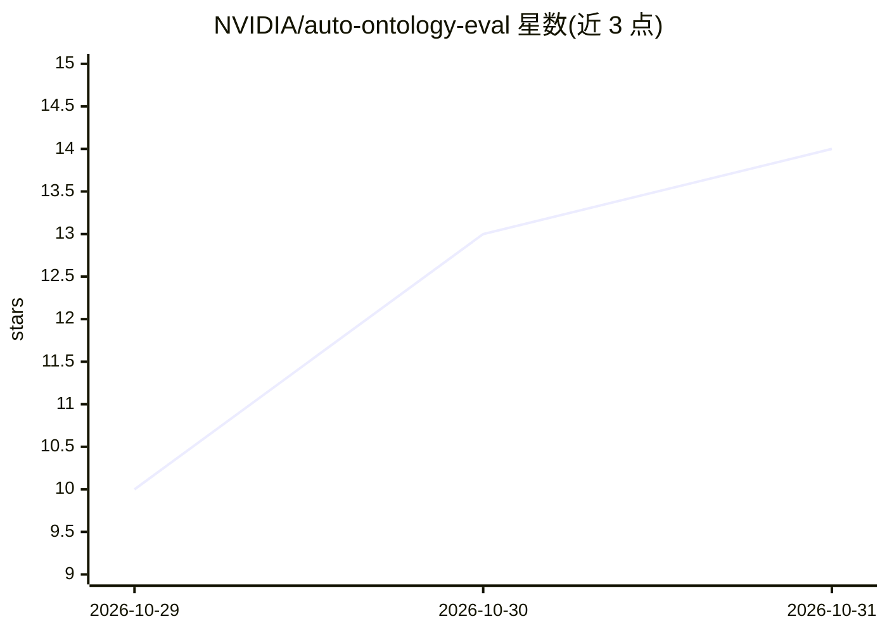

# NVIDIA/auto-ontology-eval

⭐ 14 · Python · Apache-2.0 · 推送 2026-10-30 · [GitHub](https://github.com/NVIDIA/auto-ontology-eval) · 组织维护

**Text-to-SQL 评测工具集：数据集灌入、检索评测与确定性评分**

面向 Text-to-SQL agent 的评测工具集，捆绑两条工作流：ingestion 将源数据库 schema 抽取到 Auto Ontology 的 Postgres + pgvector 存储并编译语义层；NeMo Gym 基准将评测集同时跑过 schema-only LLM 对照组与本体接地 agent 两组，由确定性执行匹配验证器评分（BIRD/BEAVER 各按官方规则），输出单一 delta，不使用 LLM judge。内置 BIRD、FDABench-Lite、BEAVER、WideWorldImporters、BIRD-Interact 五个公开数据集。运行需 uv + Python 3.13、Postgres 服务、可达源数据库与 LLM API key；uv sync 自动安装固定版本的 NVIDIA/auto-ontology。

## 筛选速览

| 维度 | 判定 | 备注 |
|---|---|---|
| AI 角色 | `ai-ecosystem` | LLM/agent 周边工具 |
| 许可风险 | `permissive` | Apache-2.0 |
| 部署形态 | `library` | 以包/库形式分发 |
| 模型依赖 | — | README 未给出锁定关系 |
| 硬件要求 | — | 无带数字的原话,不猜 |
| 安装摩擦 | `low` | 无编译、无系统依赖或容器化 |
| 成熟度 | — | 结构信号不足 |

## 能力要点

- ingestion → semantic compile → benchmark 一条命令端到端运行
- 双臂对比评测：schema-only 对照组 vs 本体接地 agent，输出 delta
- 确定性执行匹配评分，无 LLM judge（BIRD/BEAVER 官方规则）
- 内置 5 个公开数据集的种子脚本与文档

## 适用场景

- 评测自有 Text-to-SQL agent 在公开基准上的表现
- 度量本体/schema 接地对生成 SQL 质量的增量价值
- 复现 BIRD、BEAVER 等基准的对照组实验

## 场景标签

`模型评测` · 领域:评测与运维

## 证据(README 行号)

> L3: A Text-to-SQL evaluation toolkit for benchmarking a text-to-SQL agent against a
> L9: 2. **NeMo Gym benchmark** — run an evaluation set through two arms, a
> L15: much that grounding is worth against a schema-only control. No LLM judge is

## 星数曲线

2026-10-29 10 → 2026-10-31 14（+4）

---
*卡片 v1 · prompt 1.4 · 生成 2026-10-31 · 置信度 mid · 依据 README sha `8ba38cd411a0` · [字段定义](../../DATASET.md)*
